# Ziggy architecture

Ziggy is a framework for building cross-platform apps with JavaScript/TypeScript, HTML and CSS for the user interface and Zig for everything else. One app runs on Linux, Windows, macOS, Android and iOS, using each platform's system web view. The Ziggy template in this repository is an app built on it, and the last section says where each part is. The terms it uses are defined in the [glossary](glossary.md).

## How the parts communicate

Every way the parts of a running app talk to each other. The UI talks only to the backend: the native app carries the UI's messages without reading them, and anything the UI needs from the platform it asks the backend for.

| From | To | What | How |
|---|---|---|---|
| UI | Backend | A message, and the backend's message response | `window.ziggy.invoke` or `send`; the native app passes it on with `ziggy_post_message`, and the response comes back through `deliver` and `window.__ziggyReceive` |
| Backend | UI | An event | `deliver`, then `window.__ziggyReceive`, to the UI's `onMessage` listeners |
| Native app | Backend | Everything the native app needs to show the UI | `ziggy_ui_file`, `ziggy_inject_script`, `ziggy_ui_query`, `ziggy_menu_json`, `ziggy_check_url` and `ziggy_files_dropped`, in the C interface |
| Native app | UI | The page and `window.ziggy` | The native app loads the UI's files and injects the script before the page's own |
| Backend | Native app | One of Ziggy's native calls: a dialog, the OS version, quitting, a menu action, keeping a phone app running, a screenshot | A function pointer in `ziggy_config`, called from a task |
| Backend | Native app | One of the app's own native calls: anything else only the platform can do, named by the app | The `host_request` function pointer, answered by the app's own native handler |
| Native app | Operating system | Windows, menus, dialogs, permissions | The platform's own APIs |
| Backend | Operating system | Files, network sockets, threads and processes | Zig's standard library, directly. Only what needs the window or the platform's own APIs goes through the native app |
| Smoke tests | Backend | A control command, in a test hooks build only | The test control connection, a TCP socket on the loopback address |
| Backend | UI | A command the UI must perform for a smoke test | A `test-command` event; the UI answers with a `test-result` message |

In dev mode the dev host takes the native app's place: the page runs in a browser and its messages, message responses and events go to and from the dev host over a WebSocket.

## Parts

- **Core library**: a Zig library. It exposes a C interface, holds all state behind one handle, runs the task handlers on a pool of threads and answers every message the UI sends. An app adds its own channel handlers and task handlers to it, and builds the result as a static library for every target and as a shared library for Android.
- **Native apps**: one per platform. A native app creates a window, hosts the system web view, injects the `window.ziggy` script, loads the bundled UI, calls `ziggy_create`, forwards UI messages to Zig and Zig messages to the UI. A native app does nothing else except what the operating system forces (menus, dialogs, drag and drop and keeping a phone app running in the background).
- **User interface**: the TypeScript app that runs in the web view, which talks to the backend through `window.ziggy`.
- **Task queue**: part of the core library (`core/src/lib/task-queue`), which an app reaches as `@import("ziggy-core").task_queue`, so code written against the task queue runs on the core library's runner.

Ziggy and the app built on it are kept in separate places. Ziggy's code never names the app and never imports its packages. The app uses Ziggy only through its interfaces: the C interface, `window.ziggy`, the native calls and handler registration in the dispatcher and the task runner. The last section lists where each part of Ziggy is.

## Languages and native apps

| Platform | Native app | Web view |
|---|---|---|
| Linux | Zig executable | WebKitGTK 4.1 with GTK 3 |
| Windows | Zig executable | WebView2 |
| MacOS | Swift | WKWebView |
| Android | Java activity, JNI entry points written in Zig | Android WebView |
| iOS | Swift | WKWebView |

Every platform has its own native project.

## The bundled UI

The UI is built once (the app's bundler writes `dist`, Vite in the template) and every platform delivers the same files, embedded in the app's backend library, which is already part of the app, so there is no folder of UI files to install beside it. The app's `build.zig` builds its backend with Ziggy's `addAppBackend`, which calls Ziggy's `embedUi` function with the UI directory. It reads the directory every time the build runs, embeds each file with `@embedFile` and returns a module whose `files` the core library is given as `AppHandlers.ui_files` (a list of `UiFile`, each a path and its bytes). The module does not compile when `dist` is missing or has no `index.html`, so the UI has to be built first, and a changed file rebuilds the backend. Nothing else in the build is affected by a missing UI.

Every native app asks the core library for each file through the C interface (`ziggy_ui_file`, and `uiFileContent` and `uiFileContentType` through JNI on Android), so the app holds one copy of the files. The lookup of a request path and the choice of content type from the file's extension are in the core library (`ui-files.zig`), so every native app shares and tests them once. A path that is not in the list gets a not found answer. How the web view reaches the files differs:

- **Linux and Windows**: the backend library is linked into the executable, so the executable is the whole app.
  - On Linux the native app registers the URL scheme `ziggy-app` with WebKitGTK and answers each request for `ziggy-app://app/<path>` from the core library. The UI's URL prefix, which the core library's origin check allows, is `ziggy-app://app/`.
  - On Windows the native app asks WebView2 for every request to `https://ziggy-app.invalid/*` (a host name that can never be looked up) with `AddWebResourceRequestedFilter`, and answers each one from the core library in its `WebResourceRequested` handler. That address is the UI's URL prefix. WebView2's loader is linked into the executable from the SDK's static library, which needs Microsoft's toolchain to link, so there is no loader DLL beside the executable.
- **MacOS, iOS and Android**:
  - On MacOS and iOS the bridge registers a `WKURLSchemeHandler` for the `ziggy-app` scheme and answers each request for `ziggy-app://app/<path>` from the core library.
  - On Android the native app answers every request to `https://ziggy-app.invalid/` in `shouldInterceptRequest`, so the APK holds no UI files of its own.

Every native app serves the UI from an address of its own (never `file://`), so the UI's build writes relative paths and a classic script instead of a module script.

## The message bridge

The UI reaches Zig by JSON messages.

Each native app injects a script before the UI loads, taken from the core library where it is embedded (`ziggy_inject_script`), so an app supplies nothing for it. It exposes only `window.ziggy`, with `invoke`, `send`, `onMessage`, `removeAllListeners` and `getPathForFile`. It also catches a drop of files and fires it again carrying Files that give their real paths (see `get-dropped-paths` below). UI code never uses the web view's own native handle (`window.chrome.webview`, `window.webkit.messageHandlers`, the Android interface object) directly.

A message from the UI is `{ "id", "channel", "data" }`. A message response is `{ "id", "ok", "data" }` or `{ "id", "ok": false, "error" }`. An unknown channel gets an error message response, never silence. A one-way message (`send`) has no message response. An event from Zig to the UI is `{ "channel", "data" }`.

### The C interface

The native apps are written in Swift, Java and Zig, and the core library is Zig. Every native app reaches the core library through the same C interface, because C is the one calling convention all three can use. It is declared in `ziggy.h`, beside the API file:

- `ziggy_create(config)` creates the backend and returns its handle, or NULL on failure. `config` is a `ziggy_config`, and every pointer in it is copied, so it need only be valid during the call. It holds:
  - `deliver`, the function that delivers a message response or an event, as JSON, from Zig to the native app. It is required.
  - A function pointer for each native call the native app provides, NULL when the platform has none: `os_version`, `quit`, `pick_paths`, `menu_action`, `keep_alive`, `host_request` and `screenshot` (see "Native calls").
  - `user_data`, a pointer of the native app's own, passed back on every callback.
  - `worker_threads` and `max_concurrent_child_tasks`, the size of the task pool and the limit on child tasks in flight for any one parent.
  - `app_url_prefix`, the address the native app serves the UI from, and `data_dir`, the app's private data directory.
  - `test_mode` and `test_port_file`, which start the test control connection and name the file it writes its port to, in a test hooks build only.
- `ziggy_destroy(handle)` cancels every running task, waits for the workers to stop and releases everything. No task runs after it returns.
- `ziggy_post_message(handle, json_ptr, json_len)` delivers a UI message to Zig.
- `ziggy_check_url(handle, url, url_len)` decides what the web view does with an address it is about to load: load it (the app's own UI), open it in the system browser (an external link) or block it. See "Origin check".
- `ziggy_ui_file(handle, path, path_len, result)` finds a file of the bundled UI by the path of a request, for a native app that serves the UI by asking for each file.
- `ziggy_inject_script(length)` returns the script every native app injects before the UI's own, which creates `window.ziggy`.
- `ziggy_menu_json(handle, length)` returns the desktop menu as JSON, for a desktop native app to draw.
- `ziggy_parse_accelerator(text, text_len, result)` reads a keyboard shortcut such as `CmdOrCtrl+Shift+I`, for the menu.
- `ziggy_files_dropped(handle, paths_json, paths_len)` records the files dropped on the window, so the UI can ask for each one's path with `getPathForFile`.
- `ziggy_ui_query(handle, length)` returns the query of the UI's address, the text after the question mark, which the app supplies. The app's backend gives Ziggy a function (`AppHandlers.ui_query`) that returns the query text and is told whether the test mode switch is on, and the core library hands that text to the native app unread. The native app asks once the core library exists, appends `?` and the text to the UI's address (nothing when the text is empty) and loads it, so the UI's first render already holds what the app told it at start-up. No native app composes a query itself, and Ziggy names none of its parts: the template's says `testMode=1` in test mode and nothing else, and another app's can carry whatever its UI needs at start-up, such as the address of a server the backend runs. A native app that gets nothing back does not load the UI.
- `ziggy_test_hooks_enabled()` says whether the library was built with the test hooks.

A message, a message response or an event is valid only while the call or callback carrying it is running. The receiver copies it before returning and nothing is freed across the boundary. The callback can be invoked from any worker thread, so each native app delivers it to the web view on its UI thread. The core library never assumes which thread calls it.

### Delivering a message response or an event to the UI

1. Zig builds a message response or an event as JSON, from any thread.
2. The core library calls the callback the native app gave `ziggy_create`, passing the JSON.
3. The native app copies the JSON and moves to its UI thread.
4. The native app runs it in the web view: `webkit_web_view_evaluate_javascript` on Linux, WebView2's web message API on Windows, `evaluateJavascript` on Android and JavaScript evaluation on a `WKWebView` on MacOS and iOS.
5. The injected `window.ziggy` script receives it. A message response resolves the pending `invoke` promise with the same `id`. An event calls the `onMessage` callbacks registered for its channel.

### Sending a message from the UI

1. The UI calls `window.ziggy.invoke(channel, data)` or `window.ziggy.send(channel, data)`. `invoke` gives the message an `id` and keeps a pending promise under it, and `send` has no `id` and no promise.
2. The injected script posts the JSON message to the native app: through a `WebKitUserContentManager` script message handler on Linux, WebView2's web message API on Windows, the `addJavascriptInterface` object on Android and a `WKScriptMessageHandler` on MacOS and iOS.
3. The native app receives it on its UI thread and passes it to `ziggy_post_message`.
4. The core library parses it and routes it by `channel` to its handler, on a worker thread when the handler is a task. An unknown channel gets an error message response.
5. If the message had an `id`, the message response returns to the UI by the route above.

### Origin check

A native app accepts messages only from the app's own bundled UI, blocks navigation to anything else and opens external links in the system browser. Whether an address is the app's own is a Zig function in the core library (`origin-check.zig`) called by the native app, so it is written and tested once. It compares against a URL prefix the native app gives the core library (`app_url_prefix`), which is `ziggy-app://app/` on Linux, MacOS and iOS and `https://ziggy-app.invalid/` on Windows and Android.

## Tasks

The task runner runs handlers on a pool of threads inside the core library. It provides task types, task messages, task context (`sendMessage`, `isCancelled`, `maxConcurrentChildTasks`, child tasks queued and awaited), priorities and cancellation by source. The UI queues work with `add-task`, cancels with `cancel-tasks` and receives `task-message` and `task-completed` events.

- The native app passes the worker thread count and one child task limit, which applies to every parent task, to `ziggy_create`.
- Children run on the same pool as their parent. A parent that waits for children gives up its place on a worker thread while it waits, so the pool cannot deadlock when every worker is held by a waiting parent.
- Cancelling a source cancels its queued and running tasks, including children. A failed child makes `awaitTask` return its failure to the parent.
- There is one queue. An interactive task goes at the head of it and a background task at the end, so a second interactive task goes in front of the first one still waiting and background tasks keep their arrival order. A child runs at the priority it asks for, and otherwise at its parent's.

### Task queue interfaces

The core library holds the task queue (with the helpers it is written with), which the app shares, and depends on no app. It implements the task queue's `IQueueBackend` on top of its runner (`queue-backend.zig`), so code written against `TaskQueue` and `IQueueBackend` runs on it unchanged, and it sets that backend as the one the task queue hands out for the life of the core library.

- A handler registered with the task queue (`worker.registerHandler`, with its `ITaskContext`) runs on the runner for any task type the app has no entry of its own for. The app registers its handlers before it queues work. A task type that nothing is registered for fails as `UnknownTaskType`.
- A task a handler queues through the backend runs at the priority of the task running on that thread, unless it asks for one (`priorityOfRunningTask`).
- `onTaskComplete` callbacks are told of a task that ran, with its type, input and outputs, and a cancelled one as failed with the message `Cancelled`. A task cancelled while it waited in the queue is not reported to them, though the UI is told.

### Keep-alive tasks

An app registers each task type as `normal` (the default) or `keep-alive` in the Zig code that registers it (the `kind` of its `TaskHandlerEntry`), so the UI's code and the data it queues a task with do not change. A child task is covered by its parent, which lives at least as long.

The core library counts the keep-alive tasks that are queued or running, and calls one native call, `keep_alive`, with the same meaning wherever a native app provides it: true when the first such task is queued, false when the last one ends. It asks when the task is queued, because platforms require the request while the app is in the foreground. The callback is called from the thread that queued or ended the task, while the core library holds a lock, so a native app hands the work to its own thread and the callback never calls back into the core library. Only the native apps for phones provide it:

- **Android:** a foreground service (`ZiggyKeepAliveService`, with a notification whose wording the app supplies through `ZiggyShell.setKeepAliveNotification`) is started when the callback says true and stopped when it says false, so the process is not stopped when the app goes to the background. Finishing the activity still ends the app's tasks.
- **iOS:** a background task assertion (`beginBackgroundTask`) is taken and given back. The system ends it after a limited time, and the app is suspended then.
- **Linux, Windows and MacOS:** a desktop native app provides no `keep_alive` callback.

## Protocol

These are the messages that belong to Ziggy itself:

- `add-task` and `cancel-tasks` from the UI, which queue and cancel tasks. `add-task` takes `{taskType, data, source, taskId, priority}`, where `priority` is `"interactive"` or `"background"` and a missing one runs as background. `cancel-tasks` takes the source as a bare string.
- `task-message` and `task-completed` to the UI, which report a task's messages and its end. `task-message` carries `{taskId, source, message}`. `task-completed` carries `{taskId, result}`, where `result` has the fields of `ITaskResult`: `taskId`, `status` (`succeeded` or `failed`), `errorMessage` and `error` (the same text as `{message}`) when it failed, `outputs`, `type` and `inputs`. `ITaskResult` has no cancelled status, so a cancelled task is reported as failed with the error message `Cancelled`.
- `get-platform`, which reports `platformKind` (`desktop` or `mobile`), so the UI does not have to work it out from the user agent, and `os` and `arch`, the operating system and processor the backend was built for.
- `get-dropped-paths`, which the inject script sends when files are dropped on the window, and whose message response holds the real paths of the files in the last drop as an array of strings. A UI cannot read a path from a File, and WebKitGTK gives the UI no Files and hides the file addresses, so on a desktop the native app reads the paths of a drop and reports them to the core library (`ziggy_files_dropped`) before the UI's drop event runs: Linux reads them from `drag-data-received`, MacOS from the drag pasteboard and Windows has WebView2 hand over the dropped Files, which have their paths. The inject script catches the drop, asks for the paths and fires the drop again holding one empty File per path that it made and remembers the path of, and `window.ziggy.getPathForFile(file)` answers from that memory, synchronously. A phone has no drop.
- `core-error` to the UI, which reports a message that failed when there is no message response to carry the error: a message that is not JSON, or a message sent with `send`, which has no id. It carries `{error}`. The inject script logs it to the console when the UI has no listener for it.
- `menu-action` and `test-command` to the UI: a menu item that is the app's own was chosen (see "Menus"), and a command from the test control connection (see "Test hooks").

A message answered by a task (see "A message answered by a task" in the Tasks guide) runs under the task source `"request"`, so `cancel-tasks` with `"request"` cancels every one of them still running.

Every other message belongs to the app. Each channel's message and message response types are defined in the same file as its handler, so the handler is the source of truth for its payload.

## Channels

A channel is how the UI and the backend talk. The UI sends messages on a channel and the backend answers each with a message response, and the backend sends events on a channel to the UI. A channel connects the UI and the backend, and the native app only carries its messages, message responses and events. The Channels guide says how an app writes, registers and calls one, and what the UI gets when its handler fails.

## Native calls

A native call is how the backend asks the native app for something only native code can do, such as showing a file dialog, reading the operating system's version or keeping a phone app running in the background. It is a function the native app provides, and a channel is not involved: the UI never sees it. A callback connects the backend and the native app.

- **Registration:** the native app puts a function pointer for each native call it provides in the `ziggy_config` it passes to `ziggy_create`, with its user-data pointer. The core library keeps them in the handle. A native call the platform does not need is left empty, and the core library fails with a clear error if it calls one that is empty.
- **Calling:** the core library calls the function from a worker thread and waits for it to return. The native app does the work on its UI thread and returns the result, so a native call that waits for the user, like a dialog, must be called from a task and never from the dispatcher.
- **Result:** the function returns its result as a JSON message, valid only until the next call, and the core library copies it, as for any message across the C interface.

To add a native call:

1. Declare its function pointer in `ziggy.h` and add it to `ziggy_config`, at the end so a native app that fills the struct with zeroes needs no change.
2. Implement it in every native app that supports it, on the native app's UI thread.
3. Call it from the backend's handler and write the unit test with a test implementation of the native call.

### The app's own native calls

Most things only the platform can do are not worth a native call of their own: an app that has several of them (a share sheet, a permission prompt, a keychain) would add a function pointer and a change to every native app for each. The `host_request` native call is one function for all of them: the core library gives it the name of a method and the JSON text of its argument, and the native app does what the name says and writes the JSON text of its answer into the buffer it is given. A method the native app cannot do, or does not know, is answered by writing the reason in words the user can act on and returning its length negated. A task makes the request with `TaskContext.hostRequest(method, request_json)`, which gives the answer and whether the native app succeeded, and gives `error.HostCallbackMissing` on a platform with no callback. The core library knows no method names: they belong to the app's own code in its native app. It is last in `ziggy_config`, so a native app that does not provide it needs no change.

Where an app adds its own native calls, on each platform:

| Platform | Supported | Where the app adds them |
|---|---|---|
| Android | Yes | A `HostRequestHandler`, given to `ZiggyShell.setHostRequestHandler` before `start`, in the app's `MainActivity` |
| iOS | Yes | A `ZiggyHostRequestHandler`, given to `ZiggyBridge.setHostRequestHandler` before `start`, in the app's iOS project |
| Linux | Yes | A function in the `host_request` field the app's `shells/linux/src/main.zig` gives the native app (the template leaves it `null`) |
| macOS | No | Ziggy's macOS native app takes no handler yet |
| Windows | No | Ziggy's Windows native app takes no handler yet |
| Dev mode | No | The dev host takes no handler |

Where it is not supported, every one of the app's own native calls gives the task `error.HostCallbackMissing`, so an app that runs there handles that error.

### The file and folder dialogs

The `pick_paths` callback shows a native dialog: it is given what to show (open files, save a file or choose a folder), a title, an initial name (the suggested file name for a save, and for a dialog that opens files or a folder the folder it starts in) and a buffer it writes the answer into as a JSON array of paths, `[]` when the user cancelled. The native app shows the dialog on its UI thread and the calling worker thread waits, so the window stays responsive. A task asks for it with `pickPaths` on its task context.

A channel's messages can be answered by a task, so a slow answer such as a dialog never holds up the thread that handles UI messages: an app lists it in `task_channels` with the task type that answers it, and the core library queues the UI's message as that task and sends the message response when it ends. A task that fails or is cancelled gives an error message response, and a message without an id is an error.

The Ziggy template answers `pick-files`, `pick-folder` and `pick-file` this way: `pick-files` takes a title and its message response holds the paths or null, `pick-folder` takes an options object that may carry a `title` and its message response holds a path or null and `pick-file` is a save dialog that takes a suggested file name and its message response holds a path or null. Null is a cancelled dialog. A phone has no save dialog of this kind, so `pick-file` gives an error message response on iOS.

### App state and task observers

An app that has to remember things while it runs (whether a database is open, whether syncing is allowed, a timer) gives the core library a `state` in its handlers, whose functions the core library calls as it starts and stops. The core library calls `create` once the task runner is running. When the core library is destroyed it calls `stop` first, before the task runner stops, so a thread the state owns can end while tasks can still be queued. It calls `destroy` last, after the task runner has stopped, so nothing a running task reads (the state itself, a log file) is gone while a task can still run. The core library holds the value `create` returns and hands it back as `Core.app_state` to a channel handler, and as `TaskContext.appState()` to a task handler. The app casts it back to its own type, and the core library never looks inside it.

An app that has to know how every task ended, and every message a task sends, gives `on_task_end` and `on_task_message`. The core library calls them after it has told the UI, from the thread the event happened on, with no lock held, and the values they are given are valid only during the call. `on_task_end` gets the task's id, type, source and input as well as how it ended, which the UI's `task-completed` event does not need to carry because the UI knows what it asked for. An observer must not call back into something that takes the lock it is called under, and cancelling a source from inside one ends tasks on the same thread, so an app that keeps its own lock must not hold it while it cancels.

## Menus

A desktop app has a menu, written once in Zig and drawn by the native app of each desktop platform: a menu bar in the window on Linux and Windows, and the main menu on MacOS. A phone's native app never draws it. The Android native app's `menu_action` native call sends every action to the UI as a `menu-action` message, because a phone has none of the native app's own actions, so the control connection's `menu` command still works there.

The app gives the core library its menu as JSON text in `menu_json` of its handlers. It is an array of menus, each `{"label", "items"}`, where an item is `{"label", "action", "accelerator"}`, or `{"separator": true}`, and may hold its own `"items"` for a submenu. A native app reads the text with `ziggy_menu_json` and reads each shortcut with `ziggy_parse_accelerator`, which gives modifier bits and a key name so no native app parses shortcut text itself. A shortcut is modifiers and a key joined by plus signs: `CmdOrCtrl+Shift+I`, `F12`, `CmdOrCtrl+Plus`. `CmdOrCtrl` is Command on MacOS and Control elsewhere.

Every native app does these actions itself, because only the native app can: `quit`, `close-window`, `reload`, `toggle-devtools`, `toggle-fullscreen`, `zoom-in`, `zoom-out`, `zoom-reset`, `undo`, `redo`, `cut`, `copy`, `paste` and `select-all`. Any other action is the app's. The native app sends `{"channel": "menu-action", "data": {"action": "<action>"}}` to the core library, and the core library hands it to the UI as a `menu-action` event. The UI decides what it means, and the template's UI presses the same button the item stands for.

Shortcuts are registered with the window, so they work wherever the focus is, including inside the web view.

The developer tools open with `toggle-devtools` in every build, release included, and are not a test hook.

The window icon is the app's: on Linux `AppConfig.icon_png` holds the bytes of a PNG file, which an app's build gives to its main file with an `app-icon` import, and on Windows `AppConfig.icon_resource` is the number of an icon in the executable's resources, which the app's build adds from a resource script. An app with no icon passes null and shows the desktop's generic one. On MacOS, iOS and Android the icon belongs to the app's bundle, from an asset catalog or the launcher icons in the app's resources.

## Test hooks

A test hook is a feature that exists in the shipped app only so that automated tests can control it or look inside it. Smoke tests drive the real app from outside, and some things cannot be reached that way. A script cannot click a native file dialog, cannot read what the web view shows and cannot wait for the UI to finish loading, so the app has to offer a way in.

Test hooks are also a way into the app that a normal run must not have, so they are kept out of anything released. The hooks are compiled in only when the app is built for testing, with the `test-hooks` build option (`-Dtest-hooks=true`, which the core library reads as `build_options.test_hooks`), which is off by default. The release packages are never built with it, so a released app contains no test mode, no control connection and no dialog overrides to switch on. The smoke tests run the test build. An app ships only the hooks it lists, and a test sets up its state from outside the app (config files and data placed on disk) wherever it can. These are the hooks Ziggy provides, each with why the tests cannot do without it.

| Hook | Why the tests need it |
|---|---|
| A test mode switch read at start-up and passed to the UI as the `testMode` query parameter, present only in a test build | Switches on the other hooks, and nothing below is reachable without it |
| A host-side control connection, present only in a test build, bound to loopback on an operating-system chosen port written to the file `ZIGGY_TEST_PORT_FILE` names | Lets the smoke tests send commands to the running app. Ziggy's core library answers `quit`, `menu`, `screenshot`, `drop` and `pick-answer` itself, and passes every other command to the UI as a `test-command` event, which the app's UI answers (the template's answers `ready`, `click` and `get-text`) |
| The control connection's `pick-answer` command, `{"command": "pick-answer", "paths": [...]}`, in a test build | A native dialog cannot be driven from a script. The answer is used for the next dialog only, and no dialog is shown |

The native apps read two environment variables, and only in a test build: `ZIGGY_TEST_MODE` switches the hooks on and `ZIGGY_TEST_PORT_FILE` is the file the core library writes the control connection's port to (on Android the same two arrive as Intent extras, and on the iOS simulator as `SIMCTL_CHILD_`-prefixed variables). A command is one line holding a JSON object with a `command` field. The core library answers `quit` itself, through the native app's quit callback, and forwards every other command to the UI as a `test-command` event. The UI answers on the `test-result` channel, and the answer is written back as one line. The Ziggy template's UI performs `ready`, `click`, `type`, `get-value`, `get-text` and `exists`, by `data-id`. The UI tells the core library it is listening with `test-ui-ready`, and the core library holds commands until then. The control connection serves each connection on a thread of its own and handles one command at a time. The control connection's `menu` command, `{"command": "menu", "action": "..."}`, chooses a menu item as a user would: the core library calls the native app's `menu_action` native call, which runs the same function a menu click runs, so the native app's own actions (reload, zoom, developer tools, the editing commands, quit) really happen and any other action reaches the UI. Choosing reload makes commands wait until the UI says it is listening again. The template's UI also answers `viewport` (the size of the area it is drawn in) and `insert` (type text so the browser can undo it). The control connection's `drop` command, `{"command": "drop", "paths": [...]}`, records a drop of files with the core library, as the native app does when the user drops files, because no tool can drag a file into the window of an app on a virtual display. The native app's own reading of a real drop is not covered by it. The template's UI also answers `drop-file` (a drop event for a File of a given name and size). The control connection's `screenshot` command, `{"command": "screenshot", "outputPath": "<absolute path>"}`, writes a PNG of the app's window to the path: the core library waits for the UI, then calls the native app's `screenshot` native call, which takes the picture on its UI thread and returns once the file is written, or returns the reason it could not. On Linux the native app asks the web view for a snapshot (`webkit_web_view_get_snapshot`) and writes it with cairo, on Windows it uses WebView2's `CapturePreview` and on MacOS it uses `WKWebView.takeSnapshot`. The Windows and MacOS native apps have not been built or run on those systems yet. Android and the iOS simulator leave that native call empty, because a path the app is given on a phone is a path on the phone: the smoke test scripts' `send_command` takes the `screenshot` command on those platforms from the host instead, with `adb exec-out screencap -p` and `xcrun simctl io <device> screenshot`, and writes the PNG to the host path. That picture is the whole screen, status bar included. A native app without it answers `HostCallbackMissing`.

## Dev mode

Dev mode runs an app while it is developed, with the UI in an ordinary browser instead of the system web view. It is three programs:

- **The app's own dev server**, from whichever bundler the app uses (its `dev:ui` script), serves the UI with its own live reload. Nothing of Ziggy's is in it or in the bundler's config.
- **The dev host** takes the native app's place. It is a program linked with the app's backend, built with no UI in it, that calls the same C interface a native app calls: it creates the core library and carries the page's messages to it over a WebSocket. It stands in front of the dev server: the browser opens the dev host, which answers `/__ziggy` itself and forwards everything else to the dev server, putting its dev script and the inject script at the start of each page. The dev script gives the inject script the message handler it looks for, so the inject script and the core library hold nothing of dev mode and the UI's `window.ziggy` is the same as in a native app.
- **The supervisor** (`<name>-dev`) starts the dev server, builds and starts the dev host, opens the browser, and rebuilds and restarts the dev host when a Zig file of the app or of Ziggy changes.

Native calls that only a native app can answer (menus, screenshots, the app's own native calls) are missing, so the core library answers each with `HostCallbackMissing`. File and folder dialogs are shown by the dev host with zenity on Linux and are missing on Windows and macOS. A dropped file is sent to the dev host, which saves a copy and records the copy's path as the drop.

`addAppBackend` adds the dev host's build steps, `<name>-dev-host` and `<name>-dev`. Nothing else links the dev host, so no native app and no release build includes any of it.

## Where things are

- `packages/ziggy/core`: the core library (the C interface, dispatcher, task runner, origin check, native call plumbing, test hooks, the task queue and the `window.ziggy` script), which an app imports as `@import("ziggy-core")`.
- `packages/ziggy/ui`: the `ziggy-ui` package, the TypeScript types of `window.ziggy` and of the messages the backend sends.
- `packages/ziggy/native/<platform>`: the part of each native app that Ziggy provides: `linux`, `windows`, `macos`, `ios` and `android`.
- `packages/ziggy/dev`: dev mode: the dev host, which runs the app's backend in front of the app's own dev server, and the supervisor that starts them and rebuilds the dev host as the app's Zig files change. See [Dev mode](#dev-mode).
- `build.zig`: builds Ziggy and its tests, and holds the functions an app's own `build.zig` calls (`dependency`, `addAppBackend`, which adds dev mode too, `embedUi`, `addLinuxShell`, `addWindowsShell`, `addDirectoryTests`).

The Ziggy template, a small complete app built on Ziggy and kept as the reference for building an app on it, lives in `apps/ziggy-template` (its UI, Zig backend, native projects, scripts and tests). Ziggy's own test app, `apps/ziggy-test-app`, has a feature for each part of Ziggy, and Ziggy's smoke tests in `smoke-tests` drive it. It takes Ziggy as a dependency exactly as an app in another repository does, so it is also a standing test that Ziggy has not become tangled with any app: Ziggy never names one.

## See also

- [Channels](channels.md): writing, registering and calling a channel, its errors and its events.
- [Tasks](tasks.md): how to write, register, queue, follow and cancel a task.
- [Claude Code commands](claude-code-commands.md): `/ziggy:add-channel` and the other slash commands.
- [The dev host's README](../packages/ziggy/dev/README.md): what dev mode can and cannot do.
- [Integrating Ziggy](integrating-ziggy.md): the build functions an app calls and the lines it adds to use Ziggy.
- [The Ziggy template's README](../apps/ziggy-template/README.md): what the template shows and where its parts are.
