# Ziggy architecture

Ziggy is a framework for building cross-platform apps with JavaScript/TypeScript, HTML and CSS for the user interface and Zig for everything else. The same code-base builds for Linux, Windows, macOS, Android and iOS, using each platform's system web view for the frontend.

Check the [glossary](../glossary.md) to understand the jargon.

This diagram shows the main parts of a Ziggy app and how they interact:

- **The frontend** (`frontend/`): the app's HTML, CSS and TypeScript, which runs in the system web view and talks to the backend through `window.ziggy`.
- **The native app** (`native/<platform>/`): the app's native project for each platform, built on the native app Ziggy provides for it. It does the things only native code can do:
  - Opens the window.
  - Hosts the system web view.
  - Carries messages between the frontend and the backend.
  - Draws the menus.
  - Shows dialogs.
  - Reads files dropped on the window.
- **The backend** (`backend/`): the app's own Zig code, declared to Ziggy in `backend/src/app.zig`. Its message handlers and task handlers do the work on local files, network sockets, processes and so on. Message handlers run on the backend's main thread, which Ziggy starts apart from the native app's UI thread, so slow work goes in tasks, which run on worker threads and never hold up the frontend's other messages. See [Messages](../user-guide/messages.md) and [Tasks](../user-guide/tasks.md).
- **The scripts** (`scripts/`): set up, build, run, package and clean the app for each platform. See [Scripts](../user-guide/scripts.md).
- **The tests**: the frontend's unit tests (`frontend/src/test`), the backend's unit tests (`backend/src/test`) and the smoke tests (`smoke-tests`). See [Testing your app](../user-guide/testing.md).
- **The workflows** (`.github/workflows`): GitHub Actions workflows that test the app and publish a release for each platform. See [Distributing your app](../user-guide/distributing-your-app.md).

## Dev mode

In dev mode the frontend runs in an ordinary browser and the dev backend takes the place of the native app. The frontend and the dev backend exchange messages, message responses and events over a WebSocket.

[Dev mode](dev-mode.md) explains how it works.

## Native apps

Ziggy provides native code for each platform and hosts the app's frontend in a system web view. Here is what it looks like for each platform:

| Platform | Native app | Web view |
|---|---|---|
| Linux | Zig executable | WebKitGTK 4.1 with GTK 3 |
| Windows | Zig executable | WebView2 |
| MacOS | Swift | WKWebView |
| Android | Java activity, JNI entry points written in Zig | Android WebView |
| iOS | Swift | WKWebView |

## The bundled frontend

The frontend is bundled and embedded in the app and served through the native app to the system web view rather than from files on disk. Each native app serves it from an address its web view treats as a secure context in which `fetch` of the frontend's own files works, so the address depends on the web view:

- **Linux, macOS and iOS** (WebKitGTK and WKWebView): `ziggy-app://app/`, a scheme the native app registers with the web view. These web views do not let an app serve `http` or `https` addresses itself, so a scheme of its own is the only choice.
- **Windows and Android** (WebView2 and the Android web view): `https://ziggy-app.invalid/`, a host under `.invalid`, which can never be looked up, whose requests the native app answers itself. The Android web view cannot make a scheme of an app's own a secure context or let `fetch` load from it, so a frontend served from `ziggy-app://` there would lose `crypto.subtle`, `crypto.randomUUID`, the clipboard and `fetch` of its own files. WebView2 could register `ziggy-app`, but that needs an environment options object the SDK provides only in C++, so Windows uses the same address as Android.

A frontend must not depend on which address it is served from. A Content-Security-Policy in an app's frontend names both origins, `ziggy-app://app` and `https://ziggy-app.invalid`.

The smoke test scenario `24-ui-address` checks on every platform that the frontend is served from that platform's address, that the page is a secure context and that `localStorage`, IndexedDB, and `fetch` and `XMLHttpRequest` of the frontend's own files work there.

## The message bridge

- The frontend talks to the backend through `window.ziggy`, which the native app injects into the page.
- The native app passes messages to the backend through a C interface, declared and documented in `ziggy.h`. Every native app hands every message to the one entry point, `ziggy_send_message` (`sendMessage` in `core.zig`), which posts it to the core's main thread's queue and returns at once. `ziggy_create` returns that queue, and every other function of the C interface is given it.
- There are two kinds of message, kept apart from end to end. An app message belongs to the app: the backend handles it by calling the Zig handler the app registered for its name. A system message belongs to Ziggy itself (tasks, the platform, menu actions, dropped files and the test hooks): the backend handles it with Ziggy's own handlers and the app's handlers never see it.
- What the app's handler returns is sent back to the frontend as the message response.

Each message, message response and event is the JSON text of one object. The native app carries it between the web view and the backend without reading it, except to post the `menu-action` system message when a menu item it does not run itself is chosen:

| What | From | Laid out like |
|---|---|---|
| An app message | The frontend | `{"kind": "app", "id": 1, "name": "<message name>", "data": ...}`, or `{"kind": "app", "name": "<message name>", "data": ...}` for one sent with `send`, which gets no message response |
| A system message | The frontend script or the native app | `{"kind": "system", "id": 1, "name": "<name>", "data": ...}`, with no `id` when it gets no message response |
| A message response, of either kind | The backend | `{"id": 1, "ok": true, "data": ...}`, or `{"id": 1, "ok": false, "error": "<text>"}` when the message failed |
| An app event | The backend | `{"kind": "app", "data": ...}`, sent by the handler services' `sendEvent` |
| A system event | The backend | `{"kind": "system", "name": "<name>", "data": ...}` |

The `kind` field shows which kind a message or event is:

- The main thread's `handleFrontendMessage` reads the `kind` and does nothing else. It passes an app message to `runAppMessage`, which finds its name among the app's messages. It passes a system message to `runSystemMessage`, which finds Ziggy's function for its name. See "Handlers" below.
- A message that is not a JSON object, or has no `kind` or any other value, is refused as `InvalidMessage` and reported as a `core-error` system event.
- The backend refuses an app message with no name, an empty name or a name that is not a string, with `MissingMessageName` and a name no app message is registered under with `UnknownMessageName`, before any handler runs. A system message with no name is `InvalidMessage`.
- The frontend script hands an app event to the `onEvent` listeners and a system event only to Ziggy's listener for its name, so an app never sees Ziggy's own traffic.
- `window.ziggy` has no call that sends a system message of the app's choosing: each of Ziggy's own calls names its own message.
- The `id` is any JSON value the frontend chooses, and the message response carries it back unchanged.

## Handlers

- **App messages and task types.** The app declares them in `ziggy.core.App` (`app.zig`), which checks every handler when the app is built and makes the lists of messages and task types, constants of the app's code that the main thread and every worker read.
- **System messages.** Each part of Ziggy has a function for each of its system messages, in its file under `system-messages/`: the platform `get-platform`, the menu `menu-action`, the dropped files `get-dropped-paths`, the task runner `add-task` and `cancel-tasks` and the test hooks `test-result` and `test-ui-ready` in a test hooks build only. The main thread finds the function by the message's name and gives it only the piece of its state it uses. No public declaration of the core names them, so an app cannot call one.
- **The standard arguments.** Every app message handler, menu item function and app function takes the same arguments first: the handler services, the main thread's timers, its Io and an allocator. Every task handler takes the task services, its worker's timers, its worker's Io, an allocator and its context. Ziggy passes them to every handler of a kind alike and never chooses what to pass by reading a handler's parameters. The services are interfaces, as `std.Io` is: the handler services carry out each call on the main thread, and the task services send each call to the main thread as a JSON message (`services.zig`, `task-runner.zig`).
- **The app's message handlers.** `handlers.zig` wraps every app message handler in the one function the main thread calls. The wrapper parses the message's data into the handler's payload type, refusing data that does not fit with `InvalidMessageData` without running the handler. It turns what the handler returns (a result, `void`, a `ziggy.core.Response` of `.now`, `.task` or `.later`, or a `ziggy.core.MessageResult` from a handler that takes the message unparsed) into the message response. A handler that returns `.later` takes a `ziggy.core.Reply`, which posts the response to the main thread's queue. The main thread records each such message until its response comes. It reports any that never gets one as a `core-error` system event naming `MessageNotAnswered` when it stops. The [Messages](../user-guide/messages.md#what-a-handler-returns) guide lists the forms.

## The backend library

An app's backend library is built by `addAppBackend` in Ziggy's `build.zig`. Its root is Ziggy's `packages/ziggy/core/src/app-root.zig`, not a file of the app's: `createAppBackendModule` imports the app's `backend_source_file` (its `app.zig`) into it as `app-backend`. `app-root.zig` exports Ziggy's C interface (`ziggy-api.zig`) for that file's `pub const app` and, for an Android target, the JNI entry points (`jni.zig`). The app writes no exports and has no file of its own that the build starts from. A backend source file with no `app` declaration fails the build with a message reporting that.

## Protocol

The system messages, each handled by Ziggy's core library and never by the app:

| Message | From | What it does |
|---|---|---|
| `get-platform` | `window.ziggy.getPlatform()` | Answers with `platformKind` (`desktop` or `mobile`), `os` and `arch`. |
| `add-task` | `window.ziggy.addTask(task)` | Queues a task. |
| `cancel-tasks` | `window.ziggy.cancelTasks(source)` | Cancels the tasks of a source. |
| `get-dropped-paths` | `window.ziggy.getPathForFile`, when a drop happens | Answers with the paths of the files in the last drop. |
| `menu-action` | The native app | Passes on a menu item the native app does not run itself, by its name: the core calls a `.zig` item's function or sends a `.ui` item to the frontend as the app event `{"type": "menu", "item": "<name>"}`. A name the menu does not have, or a standard action, fails with `UnknownMenuItem`. |
| `test-result` | `window.ziggy.sendTestResult(requestId, result)` | The frontend's result for a `test-command`. Test hooks builds only. |
| `test-ui-ready` | `window.ziggy.testUiReady()` | Reports that the frontend is listening for test commands. Test hooks builds only. |

A system message with a name no part of Ziggy has registered gets the error `UnknownSystemMessage`.

The system events, each with its own listener on `window.ziggy`:

| Event | Listener | What it reports |
|---|---|---|
| `task-event` | `onTaskEvent` | A task sent an event while it ran: `taskId`, `source` and `data`. |
| `task-completed` | `onTaskCompleted` | A task ended: `taskId` and `result`. |
| `core-error` | `onCoreError` | A message failed with no message response to carry the error: `error`. With no listener it is logged to the console. |
| `test-command` | `onTestCommand` | A command from the test control connection: `requestId` and `command`. Test hooks builds only. |

## Tasks

- Background tasks run on a pool of worker threads in the backend, so slow work never blocks the frontend.
- Message handlers, menu functions and timers run on the backend's main thread, which Ziggy starts apart from the native app's UI thread. No thread touches another thread's state and they talk only by JSON messages, so the app's own state needs no locks. See [Threads and state](../user-guide/tasks.md#threads-and-state).
- The frontend queues a task with `window.ziggy.addTask`, can cancel it with `cancelTasks` and hears back through `onTaskEvent` and `onTaskCompleted`.
- A keep-alive task keeps a mobile app running in the background until it ends.
- The [Tasks](../user-guide/tasks.md) guide explains how to write, queue and cancel one.

## Native calls

- A native call is how the backend has the native app do something only native code can do: show a file dialog, read the operating system's version, quit, run a menu action, keep a mobile app running or take a screenshot.
- An app can add native calls of its own, which its own native code handles.
- The [Native calls](../user-guide/native-calls.md) guide explains how to use them.

## Menus

- The app declares the desktop menu once, as a `ziggy.menu.Menu` value passed to `ziggy.core.App` as `.menu` (`core/src/lib/menu.zig`). `App` checks it when the app is built and turns it, at compile time, into the menu JSON the native apps read through `ziggy_menu_json` and the table of named items the core runs. Each desktop native app builds a native menu from that JSON with the platform's own menu API. A mobile device has no menu.
- Each item names what it runs. The native app does a `.standard` item itself (quit, reload, zoom, full screen, focusing the window, the editing commands and the developer tools). Any other item it posts to the core by name as the `menu-action` system message. The core calls a `.zig` item's function on the thread that handles messages. An error it returns becomes a `core-error` system event, since the message has no id. The core sends a `.ui` item to the frontend as the app event `{"type": "menu", "item": "<name>"}`, which reaches the `onEvent` listeners.
- `menu-action` is only a system message the native apps post. It is not a system event and the frontend has no listener for it.
- [Menus](../user-guide/menus.md) explains how to write one.

## Test hooks

- Test hooks let the smoke tests drive the running app from outside, through a control connection on the loopback address.
- They are compiled in only with the `test-hooks` build option, which release builds never use.
- A command the frontend performs reaches it as a `test-command` event (`window.ziggy.onTestCommand`), and the frontend answers with `window.ziggy.sendTestResult`. The frontend reports it is listening with `window.ziggy.testUiReady()`.
- [Testing your app](../user-guide/testing.md) lists the commands.
