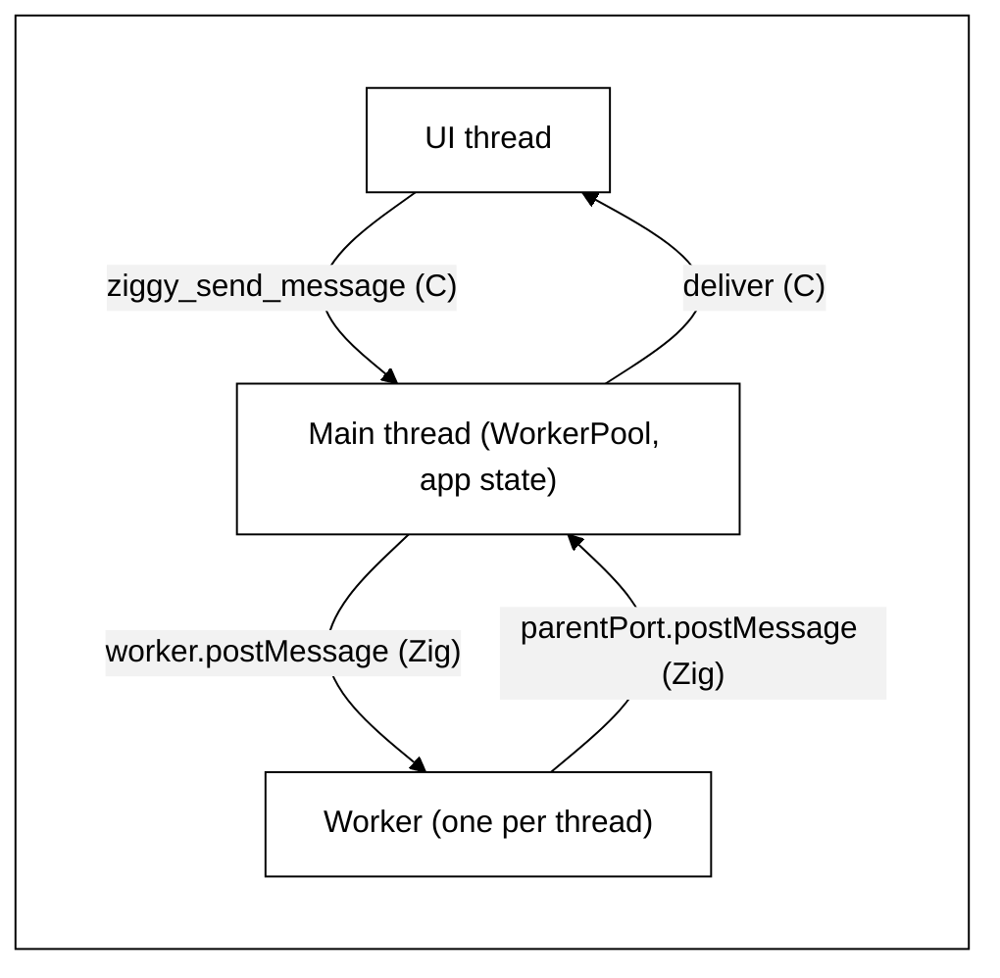
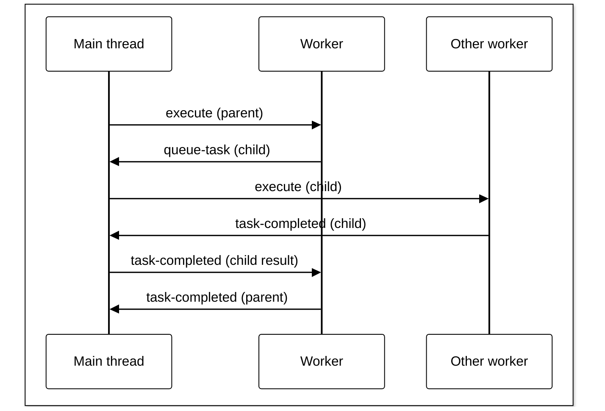

# Threads share nothing and talk in JSON messages

SHARED STATE ACCESS IS BANNED BETWEEN THREADS. ADDITION OF LOCKS AND MUTEXES TO SUPPORT SHARED ACCESS ACROSS THREADS IS A SIGNAL YOU HAVE BROKEN THE RULES.

ATTACHING AN `io` TO A STRUCT IS BANNED. A `std.Io` is never kept in a struct field: it is passed as an argument to each function that uses it. THE SAME GOES FOR EVERY SYSTEM SERVICE: an allocator, the timers (`Timers`, `TimerList`), the handler services (which menu item functions are given too) and the task services are never kept in a struct field either. Each is passed as an argument to each function that uses it.

## Banned words

Never use these words or names in this plan, in the code it produces or in reports about it. Use the TypeScript name, the existing name in the code or a word that names what happens.

- ask, answer, say, in every form (asks, asked, asking, answers, answered, answering, says, said, saying) and inside names (`Answer`). These are banned in docs, plans, comments, code names, strings and test names that this plan adds or edits. Existing uses in code and docs this plan does not otherwise change are left alone.
- host, host request, host reply (except "dev host", the existing name of Ziggy's dev mode program). The thing is a native call: the app's own native call, named by a method.
- shell, in every form and inside names (`FakeShell`, `askShell`). The word is native app.
- a `_module` suffix on any name, such as `core_module`: banned everywhere in Ziggy, Photosphere and both examples, existing uses included. A module's variable is named after the module (`core`).
- mailbox, inbox
- coordinator
- job (Photosphere's jobs are a separate frontend feature; the word here is task)
- notes (the word is messages)
- waiting (as a message or state name)
- frame, helper thread, tool thread, pump, drain, fan-out, actor
- today, currently (the plan describes only the end state)

## How it works

- The web page sends messages to the main thread. The main thread sends replies and events back to the page.
- The main thread keeps the list of tasks and the app's data. Only the main thread changes them.
- Each worker runs one task at a time and keeps its own data to itself.
- Threads send each other copies of JSON text. Nothing else is shared.

## Overview

After this plan, Ziggy, Photosphere, `ziggy-example-vite` and `ziggy-example-rsbuild` work as the TypeScript original does: every thread keeps its own state, no thread can reach another thread's memory and threads talk only by JSON messages. Ziggy's names follow the desktop app's `apps/desktop/src/lib/worker-pool-electron-main.ts`, `apps/desktop/src/worker.ts` and `apps/desktop/src/lib/worker-log-electron.ts`. The CLI's names follow `apps/cli/src/lib/worker-pool-bun.ts` and `apps/cli/worker.ts`. All are in the photosphere repository.

## Issues

1. [x] Photosphere does not build against the Ziggy checkout beside it. `build.zig.zon` pins Ziggy `v0.0.10` by git URL, as do `apps/photosphere-frontend/package.json`, the Xcode projects and `native/android/app/build.gradle`. Steps 13 to 21 cannot use the new Ziggy without a release or a change of dependency, and the plan has neither. Step 22's stop for a release comes after the Photosphere steps that already need it.
2. [ ] ~~No documentation step comes first with a stop for approval, and none comes last to match the final code. The plan changes a documented surface: `ziggy.h` (the rename, and the thread rules written on `deliver`, `keep_alive`, `host_request`, `pick_paths` and `ziggy_post_message`), `docs/user-guide/messages.md`, `tasks.md`, `menus.md`, `docs/development/architecture.md`, `dev-mode.md` and the native READMEs all name `registerMessage`, `registerTask` or `ziggy_post_message`. Nothing states later steps are revised if the human revises the docs.~~ We chose not to fix this.
3. [-] Step 3 has the main thread call the native app for each `native-app-request`. `ziggy.h` states `pick_paths` and `host_request` block until the user closes a dialog and "may take a long time", so for that whole time the main thread handles no messages, timers or task dispatch.
4. [x] Step 10 has Linux and Windows hand pick results back by message, but macOS, iOS and Android implement the same `pick_paths` and `host_request` callbacks and the plan does not state whether theirs change. No new C function to carry a result back is named.
5. [x] `native-app-request` and `native-app-response` do not exist in the TypeScript, so step 2's "laid out as TypeScript lays it out" gives them no fields.
6. [x] The TypeScript source is mixed. `IWorkerShutdownMessage` is only in the CLI's `worker-pool-bun.ts`. The `log` message is `IWorkerLogMessage` in desktop's `worker-log-electron.ts`. Desktop's `IWorkerShowNotificationMessage` is left out. Ziggy's TypeScript counterpart is `worker-pool-electron-main.ts`, yet the Overview names only the CLI files for Ziggy's names.
7. [x] `ziggy_files_dropped` returns a bool after checking the paths. Step 6 posts dropped files to the main thread, so the result is not known when the call returns, and the plan does not state what it returns.
8. [x] Shutdown is not covered: how `ziggy_destroy` stops the main thread, workers, timers and the test control thread, and what happens to a worker blocked on a `native-app-response` while the UI thread is inside `ziggy_destroy`.
9. [x] How a worker reads its own queue in the middle of a task is not described: `isCancelled` has to look at the queue without blocking, and messages that arrive while a task blocks on one child (another child's `task-completed`, `cancel-tasks`) have to be kept for later.
10. [x] The Verify grep matches code no step touches: `threadlocal var last_error` in Ziggy's `task-queue/utils/errors.zig` and Photosphere's `utils-zig/src/lib/errors.zig`, the atomics in `native/linux/src/lib/shell.zig`, the COM reference counts in `native/windows/src/lib/shell.zig`, `dev/src/lib/supervisor.zig`, `fake-shell.zig`, `message-registry.zig` and `dropped-files.zig`. No step removes them or allows them.
11. [x] `exec.zig` (Ziggy's `task-queue/utils/exec.zig` and Photosphere's `node-utils-zig/src/lib/exec.zig`) starts a thread to read stderr from inside a task, against step 17's "starts no threads of its own". The Verify grep does not look for `Thread.spawn`, so it will not catch this or any other new thread.
12. [x] Photosphere code with locks, atomics, thread-locals or threads that no step names: `apps/cli-zig/src/cmd/sync.zig`, `apps/cli-zig/src/lib/clack/core/utils/index.zig` (key-swallowing thread), `apps/cli-zig/src/lib/worker-log-bun.zig`, `photosphere-core/src/lib/background-work.zig`, `macos-host.zig`, `windows-host.zig`, `mcp-zig/src/lib/streamable-http.zig`, and in `storage-zig/src/lib/s3-client.zig` a per-call library lock, an error-name lock and a thread-local status code (step 18 covers only starting S3 once).
13. [x] Step 17 removes LAN share's threads, but `lan-share-receiver.zig` is a server with a server thread, a broadcast timer thread and a thread per connection. Step 15 gives the asset and MCP servers a pool of connection threads; nothing states how the LAN share receiver serves connections without threads.
14. [x] "After every step, `test:zig` passes" cannot hold as ordered. Step 1 builds `Worker` before step 2 defines the messages it carries. Step 4 removes `registerTask` and `registerHandler`, and step 6 removes `registerMessage`, which `dispatcher.test.zig`, `app.test.zig`, `registration.test.zig`, `task-queue.test.zig`, `worker.test.zig`, the template's `hello-world.test.zig` and the test app's `handlers.test.zig` call. Porting those tests is not a step.
15. [-] Step 8 does not state whether a task on a worker can call `setTimeout` (TypeScript workers can), nor how code reaches these functions (a global, a `Core` method, a context method).
16. [x] Step 15 does not give the connection thread limit or what happens when every thread is busy (queue the connection or refuse it).
17. [ ] ~~Step 15's Express-like framework writes a replacement for a third-party library. Photosphere's `CLAUDE.md` bans that unless the human explicitly requests it, and Ziggy's `CLAUDE.md` states text in a plan is not approval. No approval is recorded.~~ We chose not to fix this.
18. [ ] ~~Step 17 turns work that ran side by side into child tasks a parent blocks on. With step 11's limit (a parent keeps its worker), more blocked parents make it likelier that every worker holds one and the queue stops. The slowdown step 17 accepts is not measured anywhere.~~ We chose not to fix this.
19. [x] Step 10's "check iOS, macOS and Android for shared state" has no defined outcome, and the plan's last line records that which native thread calls each Ziggy function is not confirmed.
20. [x] No tests are named for: a `native-app-request` round trip, `log` messages reaching the main thread's output, `ziggy_send_message` returning before the handler runs, dropped files reaching the main thread before the page's `getPathForFile`, `ziggy_destroy` with tasks in flight, cancelling a task blocked on a child, `clearTimeout` and `clearInterval`, the CLI pool's crash handling (step 19), the connection pool when full, the spinner's and signal watcher's messages, and Android's `sendMessage` rename.
21. [x] Photosphere's smoke suites are not listed under Smoke Tests, though steps 13 to 19 change its desktop, mobile and CLI apps.
22. [x] The Verify grep for Photosphere does not leave out `third-party/`, `tmp/` or `native/android/.gradle`, which hold many matches, so "finds nothing" cannot be read off its output.
23. [x] Security: step 15 does not state which address the asset server and MCP server listen on, and the connection limit that bounds how many threads a client can make the server start is not given (issue 16).
24. [x] Step 6's `ziggy_destroy` deadlocks while a file dialog is open on Linux. `destroyCore` in `native/linux/src/lib/shell.zig` calls `ziggy_destroy` on the GTK UI thread. Step 6 has `ziggy_destroy` block until the main thread ends, and lets "a native call the main thread is in the middle of" finish first. Linux's `pickPaths` queues the dialog with `g_idle_add` and blocks until the UI thread runs it, which cannot happen while the UI thread is inside `ziggy_destroy`. Windows has the same callback to check.
25. [-] ~~Step 13 commits a path to the local Ziggy checkout into Photosphere's and both examples' `build.zig.zon`, `package.json`, Xcode projects and Android build files. Their CI and any other clone have no Ziggy beside them, so every build there breaks. Ziggy's `CLAUDE.md` states the examples pin Ziggy to a version tag. No step moves them back to a tag, and the plan no longer stops for a Ziggy release.~~ We chose not to fix this.
26. [x] Step 13 switches Photosphere to the new Ziggy before steps 14 to 21 port it, but Photosphere's tests call `registerTask` and `registerMessage` (`asset-server.test.zig`, `main-process.test.zig`, `mcp-server.test.zig`, `pickers.test.zig`, `test-support.zig` and others). "`test:zig` passes after every step from then on" fails in Photosphere from step 13 until the port is done, and the plan does not state which repository's `test:zig` it means.
27. [x] Step 18's LAN share receiver "serves one connection at a time and sends its broadcast between them". The sender finds the receiver only by those UDP broadcasts (`lan-share-sender.zig`). While the receiver is blocked in `accept` no broadcast goes out, so a sender that missed the first one never finds it.
28. [x] Step 16 stops each server "on a message from the main thread, with no shared stop flag", but the server thread blocks in `accept` (`http-server.zig`) and reads no messages there. The plan does not state how a stop message reaches a thread blocked in `accept`, or a connection thread blocked on a read.
29. [x] Step 7 has Ziggy's `exec.zig` read a child's stdout and stderr on one thread with no thread of its own, and step 18 does the same to Photosphere's. Reading one pipe until it closes while the child fills the other blocks both processes. The plan does not state how both pipes are read on one thread.
30. [-] ~~The paragraph at the top of Steps ("runs to the end without stopping", "no questions", "keep trying other ways") goes against Ziggy's `CLAUDE.md`, which requires stopping for the human when a real library will not work, when a failure is outside the machine, when a test hook is needed or when an Android emulator is missing or broken. `test:smoke:ios` and Photosphere's `test:ziggy:ios` need a Mac, and this plan runs on Linux.~~ We chose not to fix this.
31. [x] The Notes line states step 11 is the only documentation step, but step 6 edits `ziggy.h` and the template's, both examples' and Photosphere's native READMEs.
32. [x] No tests are named for: `ziggy_destroy` while a file dialog is open, stopping each server by message, the LAN share receiver being found by a sender while it serves a connection, `exec.zig` with a child that writes a lot to both stdout and stderr, the keep-awake code on the main thread (step 14) and building Photosphere and the examples against the local Ziggy (step 13).
33. [-] ~~Security: the LAN share receiver listens on every address (`0.0.0.0`, `lan-share-receiver.zig`). Serving one connection at a time (step 18) lets any device on the LAN that opens a connection and sends nothing stop the transfer for everyone else.~~ We chose not to fix this.
34. [x] Step 6 has a file dialog return as cancelled when the native app is closing, so `ziggy_destroy` never blocks on the UI thread, but step 10 leaves the Swift and Java native apps unchanged. macOS's `ZiggyPicker.swift` signals a semaphore from `DispatchQueue.main` while the calling thread blocks, and `ZiggyBridge.swift` calls `ziggy_destroy`, so macOS keeps the deadlock issue 24 found on Linux. iOS and Android are not checked. The plan also does not state how the Linux and Windows picker callbacks learn the app is closing without a flag shared with the UI thread, which the Verify grep allows only for delivery queues and COM reference counts.
35. [x] Step 7 reads both pipes "with `poll`", but `exec.zig` has its own Windows path (`runCmdExe`, Windows pipe handles) and `poll` does not work on Windows pipes. The plan does not state how Windows reads both pipes on one thread.
36. [x] Step 16 states a connection thread "closes a connection that sends nothing", but the MCP server's `GET /mcp` (`streamable-http.zig`) holds a server-sent events stream open on which the client sends nothing after its request. Those streams end on a shared `stopping` flag (its own comment states a thread blocked on a connection cannot be woken). Step 16 removes shared stop flags and gives stop messages only to the server thread, so how a held-open stream ends on stop is not covered.
37. [x] Step 16 does not state how the main thread's `mcp-tool-response` reaches the connection thread holding that tool call. The server thread reads its messages only when its accept timeout passes, and connection threads share nothing, so no route from the server thread to a given connection thread is described.
38. [x] Step 16's "the MCP server sends tool calls to the page itself" does not state how. Every other message to the page goes through the main thread (How it works), and Ziggy's `deliver` belongs to the main thread after step 6.
39. [x] Step 16 and step 18 give no value for any of the new timeouts: the accept timeout (how late a stop or a LAN share broadcast can be), the read timeout that closes a silent connection, and the LAN share receiver's.
40. [x] The Unit Tests list puts two Ziggy items under Photosphere (`ziggy_destroy` with a file dialog open) and lists a build (Photosphere and the examples building against the local Ziggy) as a unit test. The test of `ziggy_destroy` with a dialog open needs the real native app, so it cannot be a unit test, and no smoke suite names it.
41. [-] ~~Security: closing a connection that sends nothing (steps 16 and 18) does not stop one that sends a byte just inside each timeout. On the LAN share receiver, which listens on every address and serves one connection at a time, any device on the LAN can still hold it that way.~~ We chose not to fix this.
42. [x] Step 35 takes away the `Handle` that `ziggy_create` returns, but every C function in `ziggy.h` takes the pointer `ziggy_create` returns. The plan does not state what the native app holds in its place. Decision: `ziggy_create` returns the main thread's message queue, which each C function posts to. The few values the C functions read on the native app's thread (the main thread, a copy of the app URL prefix and the UI query text) are globals of the C interface, and the menu JSON and the UI files are comptime constants.
43. [x] Step 35 stops passing `*Core` to the app's callbacks (`on_create`, `on_destroy`, `on_task_end`, `on_task_event`, `ui_query`) and to its message handlers. The plan does not state what each is given instead to send to the page, queue a task or set a timer. Decision: each is given the handler services, the timers, the Io and the allocator (step 35).
44. [x] Step 34 removes `on_app_message`, `from_app`, `postHostRequest`, `readHostReply` and the app declaration's `host_request` from Ziggy. The plan does not state how Photosphere's MCP server then gets a tool call to the page and the page's response back, or how the Windows and macOS keep-awake code runs, without Ziggy carrying a hook for them. Decision: the MCP server's connection threads call the native app's `deliver` themselves with a copy of the callback and its `user_data`, and the page's response comes back through a message handler on the main thread, which posts it to the MCP server's own queue. The asset server's connection threads call the native app's `host_request` callback themselves, as before this plan (it may be called from any thread other than the UI thread). The keep-awake pass task sends an event, and Photosphere's `on_task_event` on the main thread runs the Windows or macOS code; the constant desktop values are given in the task itself. The servers' threads log to the console.

## Steps

This plan runs to the end without stopping. Once implementation begins, there are no questions and no requests for decisions. If anything blocks progress, keep trying other ways until it is unblocked, then carry on until every step is done. Work only in the local checkouts of Ziggy, Photosphere and the two examples.

Run commands with `mise exec -- bun run <script>`. Steps 1 to 6 replace Ziggy's task system as one piece: Ziggy's `test:zig` passes after step 6 and after every later Ziggy step. Steps 13 to 20 port Photosphere as one piece, including its tests that call `registerTask` or `registerMessage`: Photosphere's `test:zig` passes after step 20.

### Ziggy (`github.com/ashleydavis/ziggy`)

- [x] 1. **Message types.** Add `IWorkerMessage`, `IWorkerCancelTasksMessage`, `IWorkerShutdownMessage`, `IWorkerReadyMessage`, `IWorkerTaskCompletedMessage`, `IWorkerTaskMessage`, `IWorkerQueueTaskMessage`, `IWorkerLogMessage`, `native-app-request` and `native-app-response`. Each one TypeScript has is laid out as the TypeScript one is. `native-app-request` carries a request id, the native function to call and its JSON input. `native-app-response` carries the same request id and the JSON result or the error. Desktop's `IWorkerShowNotificationMessage` is left out: no Zig task shows a notification.

      Summary: `worker-messages.zig` holds every message, laid out as the TypeScript one, and `worker-messages.test.zig` checks each encodes to the JSON TypeScript sends. Two were added: `console` (a line a worker wrote to its console, which only the main thread writes) and `worker-error` (a worker that could not start, which TypeScript sees as the worker's `error` event).
- [x] 2. **Workers.** Add `Worker`, `worker.postMessage` and `onmessage` for the main side. Add `initWorker`, `executeTask`, `parentPort.postMessage` and `onmessage` for the worker side. The queue that carries messages is the only place a lock may appear.

      Summary: `worker.zig` and `message-queue.zig`. The queue is the only lock. A worker uses the test providers of uuids and time when `NODE_ENV` is `testing`, as TypeScript does, and makes its session id when none is given. A worker that cannot start sends `worker-error` and ends, and both pools let it go. Decision: a thread cannot be stopped from outside it, so `Worker.abandon` (TypeScript's `terminate`) leaves its thread running and keeps its memory.
- [x] 3. **Task context.** A running task sends events, queues and waits on children and checks for cancel only by message. `isCancelled` takes the messages already in the worker's queue without waiting. While a task waits on one child, any other message that arrives (another child's `task-completed`, `cancel-tasks`) is kept in arrival order and handled when the task next looks. A task makes requests to the native app only by message: a task that needs the native app to do something, such as show a file picker, sends `native-app-request` to the main thread, which calls the native app and sends the result back as `native-app-response`.

      Summary: `TaskContext` in `task-runner.zig` does all of this by message, keeping other messages in order while it waits. A worker also has timers (`setTimeout` and `clearTimeout` through the queue backend), which run while its task waits, and are cleared when the task ends. A task's request to the native app (`hostRequest`) that neither the native app nor the app handles fails as `HostCallbackMissing` (covered by a new test in `task-runner.test.zig`).
- [x] 4. **`WorkerPool`.** The main thread owns the task list, an `IWorkerState` per worker, `handleWorkerMessage`, `dispatchTask` and `tryDispatchPending`. Task types come only from the app's `.tasks` list: remove `Core.registerTask` and `registerHandler`. Port every test that calls them to the app declaration.

      Summary: `worker-pool.zig` runs on the main thread; `registerTask` and `registerHandler` are gone and their tests use the app declaration. On shutdown the pool cancels the running tasks and waits for the workers. Decision: Ziggy's pool has no task timeout, as the desktop TypeScript pool's tasks are not timed.
- [x] 5. **Task-queue package.** Port the TypeScript `WorkerQueueBackend`, which sends a task's child tasks to the main thread as `queue-task` messages. Remove the package's process-wide backend, its process-wide handler list and its locks. The mock worker pool that tests use runs tasks on real `Worker`s that talk by message.

      Summary: `WorkerQueueBackend` is ported; the process-wide backend, handler list and locks are gone. `IQueueBackend` gained `waitForMessage` and optional `setTimeout` and `clearTimeout`, which is how a thread's own code waits and keeps timers. `MockWorkerPool` runs real `Worker`s and owns timers.
- [x] 6. **Main thread.** Ziggy starts a main thread, separate from the native app's UI thread, that owns all of the core's changing state, including the message handlers and the dropped files (remove their locks). Calls from the native app and replies a handler sends later are posted to it. `ziggy_send_message` passes the web page's message to the main thread and returns at once. The handler runs later, on the main thread. `ziggy_files_dropped` checks the paths on the calling thread, returns that result and posts the paths to the main thread. Remove `Core.registerMessage`: message handlers come only from the app declaration, as task types and menus do. Port every test that calls it. The C function `ziggy_post_message` is renamed `ziggy_send_message`, to match the page's `send`, in Ziggy's header, every caller (Ziggy's native apps and the dev host), Android's Java method `ZiggyNative.postMessage` (renamed `sendMessage`) and every README that names it (the template's, both example apps' and Photosphere's native apps'). `ziggy_destroy` posts a stop to the main thread and waits for it: the main thread clears its timers, sends `IWorkerShutdownMessage` to every worker, stops test control and waits for all of them to end. A native call the main thread is in the middle of finishes first. Every native app closes any open file dialog on its UI thread before it calls `ziggy_destroy`, so a waiting pick returns as cancelled and `ziggy_destroy` never waits on the UI thread it was called from.

      Summary: `core.zig` starts the main thread, which owns the core's state. The rename to `ziggy_send_message` and `sendMessage` reaches the header, the native apps, the dev host, Java and the READMEs. The Linux native app closes its UI requests before it quits, and a new desktop smoke scenario, `25-close-with-dialog-open`, quits while a real dialog is open. Two additions: the app declaration's `host_request`, which handles a task's request to the native app on the main thread when the native app has no callback for it (how Windows and MacOS keep awake), and `Core.setMainLog`, which `on_create` uses to give the main thread its log.
- [x] 7. **Logs and globals.** Remove the shared log, console and environment globals. A worker logs by sending an `IWorkerLogMessage`. Only the main thread writes stdout, stderr and log files. Ziggy's `exec.zig` reads a child process's stdout and stderr on the calling thread, with no thread of its own, by waiting on both pipes at once and reading whichever has data: `poll` on Linux, macOS and Android, overlapped reads waited on together on Windows.

      Summary: the log, the console capture and the environment are per thread. A worker forwards its log and console lines to the main thread, and is given a copy of the environment. An error a worker logs with its cause reaches the main thread's log as one error line with the cause under it, as the worker's own log would write it (new test). `exec.zig` reads both pipes on the calling thread. Decision: in a test program a line written to stdout by a thread with no capture goes to stderr, because Zig's test runner talks to the build over stdout and such a line stopped the build from hearing the results.
- [x] 8. **Timers.** Add `setTimeout`, `clearTimeout`, `setInterval` and `clearInterval`, whose callbacks run on the main thread. The main thread's wait for messages times out when the next one is due.

      Summary: `timers.zig`, and `Core.setTimeout`, `clearTimeout`, `setInterval` and `clearInterval`, run on the main thread, which waits until the next one is due.
- [x] 9. **Test app and test control.** The test app's media server task stops on cancel without a thread that watches for it. Test-control's threads share no state with the main thread and exchange messages with it.

      Summary: the media server task looks for its cancel between waits; test control exchanges messages with the main thread, which handles them only in a build with test hooks. The test app's pick-files button yields once (`setTimeout(0)`) before it sends its message, so the smoke test sees its click first.
- [x] 10. **Native apps and dev host.** In the Linux and Windows native apps (Zig), the UI thread hands pick and screenshot results back to the waiting thread by message. The dev host's threads share no state. The Swift and Java native apps change only for the `sendMessage` rename and closing an open file dialog before `ziggy_destroy` (step 6).

      Summary: done in the Linux and Windows native apps and the dev host; the Swift and Java apps changed only as step 6 describes.
- [x] 11. **Task queue design doc.** In `docs/development/diagrams/task-queue.md` (and `docs/user-guide/tasks.md` where it covers the same ground), record that a task waiting on its child tasks keeps its worker, so if every worker holds a waiting parent the queue stops until a task times out, as in TypeScript. Note it is not a problem in practice and may have to be addressed later.

      Summary: `task-queue.md` has a section "A parent waiting on its children"; `tasks.md`, `messages.md` and `architecture.md` now name the backend's main thread as where the handlers run.
- [x] 12. **Check Ziggy.** Run the grep from Verify and the Ziggy smoke suites.

      Summary: the grep finds only the threads the plan allows (the main thread, workers, the message queue, test control, the dev host and supervisor, the fake native app) and the test app's media server, which is test-only. After the last change to the core: `test:zig` (534 passed, 2 skipped), `test:zig:android`, `test:smoke` (23 passed), `test:smoke:dev` (15 passed) and `test:smoke:android` (15 passed). The task queue test "callers awaiting different tasks each resolve when their own task completes" crashed one run in four: it let both tasks end at once, and a task that ends before it is awaited is no longer tracked, so the second `awaitTask` returned null. Every real caller awaits a task as soon as it adds it. Decision: the test holds the second task until the first has been awaited, with its assertions unchanged. `test:smoke:ios` needs a Mac and was not run.
- [x] 13. **Point Photosphere and the examples at this Ziggy.** Every Ziggy dependency in Photosphere and both examples (`build.zig.zon`, the frontend `package.json`, the Xcode projects and the Android build files) points at the local Ziggy checkout beside it.

      Summary: `build.zig.zon` uses `.path = "../ziggy"`, the frontends `file:../../../ziggy`, Android `includeBuild`, and the Xcode projects a local Swift package reference. In each worktree, `../ziggy` is a symlink to this Ziggy worktree.

### Photosphere (`github.com/ashleydavis/photosphere`)

- [x] 14. **App state on the main thread.** Remove the global app state and every way a task reaches it. Photosphere's node-api task types move into its `.tasks` list. Remove the timer thread: its timers become `setTimeout` and `setInterval` calls, as in the TypeScript app. The macOS and Windows keep-awake code runs only on the main thread: remove its locks.

      Summary: `main-state.zig` has no lock; the state is made in `on_create` and used only on the main thread. The node-api task types are in the app's `.tasks` (`task-handlers.zig`, `task_entries`). The timer thread is gone: the periodic and debounced sync, the automatic import check, the single-instance check and the background passes use the core's timers. The Windows and MacOS keep-awake code has no lock and runs through the app's `host_request`, on the main thread (a Ziggy test checks the app's `host_request` runs there).
- [x] 15. **Tasks stop touching app state.** A task gets its inputs in its data and sends results back as events or its result. The main thread applies them.

      Summary: `main-process.zig` applies what each task reports when it ends (database opened or closed, background work, config, the automatic import check's result, background pass results, sync and import ends) and forwards a task's `app-event` events to the page. `set-config` of an automatic import setting runs the check as a child task and fails its reply when the check fails, as TypeScript awaits `ensureAutoImport`. `get-log-details` is given the path of the main thread's log file, which a task cannot reach.
- [x] 16. **Asset server and MCP server.** These are Photosphere's own threads and have nothing to do with Ziggy. Extend Photosphere's existing HTTP server (`http-server.zig`, which both servers already use) into a small Express-like framework for Zig: routes by method and path, with request and response helpers. It has only what these two servers need. The server thread accepts connections and hands each to a connection thread from a pool that starts one thread up front, starts more as connections arrive up to a limit and reuses them after that. The limit is passed in by each server. When every thread is busy, a new connection waits until one is free. A connection thread keeps its own state and shares nothing with the others. Each server owns its sockets and state (asset storage, pending MCP tool calls), keeps listening only on the loopback address as it does now and stops on a message from the main thread, with no shared stop flag. The server thread waits for a connection with a timeout of about a second and reads its messages each time the timeout passes. Each connection thread has its own message queue that the server thread posts to. It reads with the same timeout so it sees its messages, including stop. A held-open MCP event stream ends when its connection thread gets stop. The main thread opens the asset server's socket before starting it, so it knows the port without a message. The MCP server sends tool calls to the page itself through the native app's `deliver`, which any thread may call. The main thread passes the page's `mcp-tool-response` on to the MCP server thread as a JSON message. The server thread keeps which connection thread holds each tool call and posts the response to it.

      Summary: `node-utils-zig/src/lib/http-server.zig` is the framework (`Router`, `Request`, `open`, `HttpServer.start`, `stop` and `post`, with `maxConnectionThreads`, a state per connection thread, a log for the server's threads and an environment for them, since the environment is per thread and a connection thread reads it to find a database's credentials; new test). The asset server (`node-api-zig/src/lib/asset-server.zig`) is no longer a task: the main thread opens its socket when the page's query needs its address, and each connection thread has its own core. The MCP server runs a connection per thread and holds each tool call by key. Both asset servers (the app's and the REST API's) and the MCP server give their connection threads a copy of the environment of the thread that started them. Decisions: a connection that sends nothing is given up after `IDLE_LIMIT_MS`; the server's threads log to the console unless the owner gives them a log.
- [x] 17. **Logging.** Log files belong to the main thread. Remove the logger's locks, queue and writer threads. Remove the CLI's shared worker log routing.

      Summary: the file logger writes on the main thread with no lock, queue or thread (in photosphere-core and the CLI). The CLI's worker log routing is gone: the pool writes each worker's lines prefixed with the worker and task, as `WorkerLogBun` did. The test of lines logged from several threads at once was deleted: only the main thread logs now.
- [x] 18. **Shared state in tasks.** Remove locks, caches and extra threads from media sources, hash cache, asset serving, LAN share, cached storage, import, encrypt, decrypt, building the file tree, prefetch, retry, the debounce and Photosphere's `exec.zig`. A task runs only on its own worker thread and starts no threads of its own, as in TypeScript. Work that could run side by side runs as child tasks or one piece after another, which may be slower. The LAN share receiver serves one connection at a time on its task's thread. It waits for a connection with its existing broadcast interval as the timeout and sends its broadcast each time the timeout passes. Photosphere's `exec.zig` reads both pipes the same way as Ziggy's.

      Summary: the locks, caches and extra threads are gone from all of these. Photosphere has no `exec.zig` of its own: it uses Ziggy's (step 7). Decisions: the cached storage downloads a file before it streams it; encrypt, decrypt, the file tree and prefetch run one piece after another; `retryOnce` runs the operation with no timer racing it, and `checkDatabaseExists` keeps its bound by giving its S3 requests a time limit that cancels a request at it; the import and the debounce wait on the queue backend's timers. The LAN share receiver serves one connection at a time and keeps announcing itself while it waits on one, and its waits and the sender's are on the task's `Io` (new test: a sender finds the receiver while it serves a connection).
- [x] 19. **Shared libraries.** Vaults per task. S3 and Winsock start once on the main thread. Remove S3's per-call library lock and its error-name lock. ffmpeg and ImageMagick are libraries each task calls on its own thread: remove the locks around them. The CLI spinner thread and the CLI's key-swallowing thread are Photosphere's own: each keeps its own state and gets its messages from the main thread, with no shared fields or lock. The CLI's signal watcher thread sends a message to the main thread, which runs the signal callbacks, including stopping `sync --watch`.

      Summary: the vaults, the keychain check, S3's interned error names and the mime table are per thread. S3 and Winsock start once. The ffmpeg and ImageMagick locks are gone. Decision: FFmpeg's command-line code keeps process-wide globals, so ffmpeg runs take turns through a message queue holding one token. The spinner's thread and the key-swallowing thread each get their messages on a queue of their own (new test: the key-swallowing thread swallows keys until it is sent stop). The signal watchers post to the main thread's queue, which runs the callbacks. The CLI's main thread has a queue of its own from the start (`termination.useOwnMainQueue`), so a Ctrl+C reaches a LAN share, which starts no worker pool; while only that queue is set, a signal that ends the process is handled by the watcher, which shuts the process down itself, as it does before there is any queue.
- [x] 20. **CLI worker pool.** Rewrite it as a port of the TypeScript `WorkerPoolBun`, keeping its crash handling.

      Summary: `apps/cli-zig/src/lib/worker-pool.zig` runs Ziggy's workers, with the timeouts, the crash handling (a worker that cannot start is logged as "Error from worker N" and replaced) and the callbacks of `WorkerPoolBun`. Shutdown cancels the running tasks and waits for the workers, as Ziggy's pool does. Decisions: a timed-out task's worker is abandoned and replaced without stopping an ffmpeg it is running; a pool whose workers were abandoned closes and keeps its queue when it is freed, so a late message from one is dropped (new test); the pool takes the task types its workers run as an option, as TypeScript's takes the worker script.
- [x] 21. **Tests with globals.** Test helpers build their state per test.

      Summary: `test-environment.zig` makes an environment per test (shared by a test and the fixtures it uses), and threads a test starts are given a copy of it. photosphere-core's `TestApp` starts the environment before the core (`prepare` and `launch`), runs its checks of the app's state on the main thread through a message only the tests' copy of the app has, and captures the main thread's console there. Tests deleted because their subject is gone: stopping an ffmpeg run from another thread, the retry tests that raced a timer, lines logged from several threads, the `worker_log_bun` tests and the asset server task's tests (replaced by tests of `AssetServer`). Photosphere's `zig build test` after the last code change: 3891 package tests and 519 CLI tests pass.
- [x] 22. **Check Photosphere.** Run the grep from Verify and `tev`.

      Summary: the grep finds only the signal watcher, the HTTP framework's pool, the spinner, the key-swallowing thread, the signal handling and the S3 error name `ConditionalRequestConflict`, besides test-only code. Decision: a `tev` run was killed for lack of memory, so its suites ran one at a time instead, each passing after the last code change: `compile`, `test`, `test:zig` (4434 passed, 6 skipped), `test:cli:zig`, `test:ziggy` (66 passed, 2 skipped) and `test:ziggy:and` (64 passed, 2 skipped, then scenarios 1 and 25 passed after their fixes below). `test:ziggy:ios` needs a Mac and was not run. Fixes the suites found: the asset servers' and the MCP server's connection threads had no environment, so a database's S3 credentials could not be found (scenario 45); a worker's error with its cause reached the app's log as two error lines (scenario 25); scenario 25 allowed a different error text on a phone, but the listing now runs as the same task everywhere, so it allows the same line on every platform; scenario 1 looked for the asset server task's log line, which is now `Asset server listening on`. One `test:ziggy` run had scenario 4's app killed with SIGKILL while it started, with no record in the kernel's or `systemd-oomd`'s logs while swap was heavily used; nothing in the app or the harness sends SIGKILL to it, the scenario passed alone and the whole suite passed on the next run.

### Example apps (`ziggy-example-vite`, `ziggy-example-rsbuild`)

- [x] 23. **Examples on the new Ziggy.** Carry over the template's changes to each example and run its full test set.

      Summary: each example's backend test sends its messages with `shell.send`, as the template's does, and its Windows README names `ziggy_send_message`. In both examples `compile`, `test`, `test:zig`, `test:smoke` and `test:smoke:android` pass against this Ziggy. `test:smoke:ios` needs a Mac and was not run.

### Zero shared state

Shared state between Zig threads is banned. All communication between threads is done with JSON messages. The only thing two threads both touch is a message queue, and the only thing that crosses it is a copy of JSON text. Constants compiled into the program (task tables, functions) are not state. Where a library or the operating system leaves no way to do something without a process-wide variable (an operating system signal handler is given no arguments), stop and raise it with the human before writing code for it.

- [x] 24. **The rule in CLAUDE.md.** Add to the `CLAUDE.md` (and `AGENTS.md` where there is one) of Ziggy, Photosphere and both examples: shared state between Zig threads is banned, and all communication between threads is done with JSON messages.

      Summary: the bullet "SHARED STATE BETWEEN ZIG THREADS IS BANNED. All communication between threads is done with JSON messages: the only thing two threads both touch is a message queue, and the only thing that crosses it is a copy of JSON text." heads the Rules of the `CLAUDE.md` of Ziggy, Photosphere and both examples. None of the four has an `AGENTS.md`.
- [x] 25. **Each thread owns its `Io`.** The main thread, each worker and test control's thread make their own `Io` on their own thread, as the HTTP framework's connection threads do, instead of using the `Io` of the thread that started them.

      Summary: `MessageQueue` holds no `Io`: each call takes the calling thread's. Ziggy's main thread (`Core.mainThread`), each worker (`initWorker`), test control's accepting and connection threads, the dev host's threads and Photosphere's HTTP server and connection threads each make a `std.Io.Threaded` of their own on their own thread. A worker's tool runner is made on the worker's thread with the worker's `Io` (`RunnerMaker`). The signal watcher threads and the thread Windows calls a console control handler on post with an `Io` of their own.
- [x] 26. **The native app holds only the main thread's queue.** The main thread makes the core's state on its own thread. The native app's side keeps only what it needs to post to the main thread's queue and to wait for the main thread to end, so `ziggy_send_message`, `ziggy_files_dropped` and the other C functions touch nothing the main thread uses.

      Summary: `Core.create` returns a `Handle` holding the main thread's queue, the main thread and copies of what the C functions read (the app URL prefix, the menu, the UI files, the UI query and the control port). The main thread builds the core in `mainThread`, runs `on_create` there and reports the control port or the error by message. `ziggy_send_message`, `ziggy_files_dropped` and the other C functions post to the queue through the handle. A reply that is ready at once is given on the main thread, and any other is posted as a later reply. A thread of the app's own posts on the `from_app` channel, which the app reads with `on_app_message` (`docs/user-guide/app-declaration.md`). The test "an app's on_create runs on the core's main thread" and the main-thread tests of the app's own threads cover it.
- [x] 27. **Ziggy's other threads.** Test control's thread, the dev host's accepting and connection threads and the dev supervisor's progress thread are given no pointer to their starter's data (test control's own struct, the dev host's connection, listener and accept queue, the supervisor's `finished` flag). Each gets copies of what it needs when it starts and everything else by message.

      Summary: test control's accepting thread is given an `AcceptStart` (its listener, the main thread's queue and the poll interval) and each connection thread a `ConnectionStart`. They report to the main thread by message, an "ended" message included, and stop on a message (`beginStop`). The dev host's accepting thread owns the listener, and its connection threads are given copies of the connection options. The supervisor's progress thread reads a `MessageQueue` in place of the `finished` flag.
- [x] 28. **FFmpeg and ImageMagick on each thread.** A worker whose task needs `magick`, `ffmpeg` or `ffprobe` runs it on its own thread, whenever the task needs it, with state of its own made on that thread. Remove the one `MediaTools` the main thread makes and hands every worker through `tool_runner`, and remove `Ffmpeg.turns`, so ffmpeg runs no longer take turns. FFmpeg's command-line code (`ffmpeg` and `ffprobe` in `third-party/ffmpeg`, vendored from FFmpeg 9.0.2) keeps its state per thread: every file-scope and function-scope `static` variable and global it writes is made thread-local, as ffmpeg-kit did for FFmpeg 6 for its concurrent execution (`https://github.com/arthenica/ffmpeg-kit`, `android/ffmpeg-kit-android-lib/src/main/cpp/fftools_ffmpeg.c`), including the signal flags (`received_sigterm`, `received_nb_signals`), which ffmpeg-kit left shared. The human approved this change to the third-party source. It is a patch file in `third-party/ffmpeg` that `update-ffmpeg.sh` applies after it vendors the source, so an update keeps it, and `update-ffmpeg.md` describes what the patch is for. A new test runs `ffmpeg` and `ffprobe` on several threads at once and checks each run's output. ImageMagick's error and warning handlers and FFmpeg's log callback report to the log of the thread that runs the command.

      Summary: each worker makes its own runner of `magick`, `ffmpeg` and `ffprobe` on its own thread through `MediaTools.runnerMaker` (Ziggy's `RunnerMaker` no longer carries a queue), and `Ffmpeg.turns` is removed, so runs no longer take turns. `third-party/ffmpeg/fftools-per-run-state.patch`, which `update-ffmpeg.sh` applies after it vendors the source and `update-ffmpeg.md` describes, moves every global and static variable of FFmpeg's command line programs, the signal flags included, into the state of one run. `ffmpeg_run` and `ffprobe_run` (`ffmpeg-main.c` and `ffprobe-main.c`) start a run on the calling thread. The new test "ffmpeg and ffprobe run on several threads at once, each run giving the output of its own arguments to its own thread's log" passes. Decisions: thread-local variables alone, as ffmpeg-kit used for FFmpeg 6, do not work for FFmpeg 9, whose scheduler starts threads that read the state, so the state is one struct per run reached through a thread-local pointer that the scheduler gives each thread it starts. The patch also installs no signal handlers, leaves stderr's buffering and the library search path alone, keeps the log level, flags and callback per run, and refuses `-cpuflags`, `-cpucount` and `-max_alloc`, which set libavutil values for the whole process. FFmpeg's log callback and ImageMagick's handlers and genesis are one per process by the libraries' design, so the main thread sets them once (`Started`). Each run's log messages go to a queue of the run's own, which the thread that ran the command writes to its own log, and ImageMagick's handlers write to the calling thread's log. A message logged on a thread of FFmpeg's libraries' own, which belongs to no run, goes to that thread's log when it is an error. The patched library was built for Linux, Android and Windows; macOS and iOS need a Mac and were not built.
- [x] 29. **HTTP servers share nothing with their connection threads.** A connection thread is given copies, not pointers: its own copy of the environment, of the server's options (the session id) and of anything else it reads. No connection thread holds the server's struct (`AssetServer`, `RunningMcpServer`), the `hostRequester` or the core. The MCP server's connection threads send a tool call to the main thread as a message, and the main thread passes it to the page.

      Summary: Photosphere's HTTP framework gives each connection thread a `ThreadStart`: its own copies of the environment, of the connection config (the session id and the keychain) and of the main thread's queue, and the thread makes its own state with `connectionState.create`. Routes are constants. The asset server's connection threads build an asset server core of their own (`createOwnAssetServerCore`) and reach the main thread by message. The MCP server's connection threads post a tool call to the main thread (`handleAppMessage`), which passes it to the page and posts the page's response back to the connection thread that holds the call. No connection thread holds `AssetServer`, `RunningMcpServer` or the core.
- [x] 30. **No process-wide variables in Photosphere.** Each of these becomes data owned by the one thread that uses it, passed to what needs it: `main_state` (`main-state.zig`), `mediaSourceBuilders` (`media-source-registry.zig`), `spawn_function` (`keychain-types.zig`), `library_initialized` (`s3-client.zig`), `winsockStarted` (`socket.zig`), the variables of `termination.zig` and `process-signals.zig`, the CLI's `fileLogger` (`log.zig`), the prompts' standard input and output (`clack/prompts/common.zig`), `process_argv` (`process-argv.zig`) and the colour support of `picocolors.zig`.

      Summary: `main_state`, `mediaSourceBuilders`, `spawn_function`, `library_initialized`, `winsockStarted`, the CLI's `fileLogger`, the prompts' standard input and output, `process_argv` and picocolors' colour support are thread-local, each set and read only by the thread that uses it, and each worker registers the media source builders for itself (`on_worker_start`). `termination.zig` and `process-signals.zig` keep their callbacks, listeners and the main thread's queue as the main thread's own. The CLI's main thread has one queue for its whole life (`useOwnMainQueue`), which the worker pool reads and which each signal watcher thread is given when it starts, with its pipe's read end. A signal is handled when the main thread next reads its queue, as Node runs a signal handler on its event loop. The CLI pool numbers its workers per main thread, so a late message from a worker an earlier pool abandoned is dropped (the test "a worker abandoned at its timeout can still send once the pool is gone, and what it sends is dropped"). Decision: a POSIX signal handler and the Windows console control handler are given nothing of the program's, so each of the two modules keeps the one value its handler needs as a variable of the whole process, set before the handler is installed and only read after: the pipe's write end on POSIX, the main thread's queue on Windows.
- [x] 31. **The spinner and key-swallowing threads.** Each is given only its own message queue and copies of what it needs when it starts, not its starter's struct (the spinner is given `self`, the key-swallowing thread `blocked`).

      Summary: the spinner's animation thread is given an `Animation`: copies of its pictures (coloured before the thread starts), its delay, the file it writes to and its own queue, and it writes through a writer of its own (`SpinnerOptions.outputFile`). The key-swallowing thread is given a `SwallowStart`: its queue, the terminal, the mode to put back and what to do with the cursor. Neither holds its starter's struct.
- [x] 32. **Check zero shared state.** In both repositories and both examples, outside test-only code, every top-level `var` is gone or `threadlocal`, and every `std.Thread.spawn` is given only message queues, copies and constants. Run the grep from Verify and every suite the steps above touch, in each repository, and the examples' full test sets.

      Summary: outside test-only code, the only top-level `var`s left in either repository or example are the signal values of step 30, and every `std.Thread.spawn` is given queues, copies or constants. The Verify grep finds only the threads started on purpose, the message queue and Ziggy's test-only fake native app (`fake-shell.zig`). Passed after the last code change: Ziggy `test:zig`, `test`, `test:smoke`, `test:smoke:dev`, `test:zig:android` and `test:smoke:android`; Photosphere `compile`, `test`, `test:zig`, `test:cli:zig`, `test:ziggy` and `test:ziggy:and`; each example's `compile`, `test`, `test:zig`, `test:smoke` and `test:smoke:android`. The iOS suites need a Mac and were not run.

### Undo what went beyond the threading model

This plan changes the threading model and background tasks only. Every change that is not needed for those is undone. Ziggy knows nothing of Photosphere: no library it uses, no service it runs, no thread it starts. The CLI's UI and commands carry no threading changes. Git is used only to read (`git show HEAD:<path>`, `git diff HEAD`): it never stages, unstages, restores or reverts. A file is put back by reading its `HEAD` content with `git show` and writing it with the editor tools. These steps override steps 28, 30 and 31 where they conflict.

- [x] 33. **Ziggy names no tool.** Remove `task-queue/utils/in-process-tools.zig`, `RunnerMaker`, `InProcessRunner`, the `tool_runner` option of both worker pools and of `Worker`, and the `tools` argument of `exec`, from Ziggy and its tests. Ziggy's `exec` only starts programs. Photosphere's code that runs `magick`, `ffmpeg` or `ffprobe` calls its media-tools package itself, on the task's thread, when the task needs it. A grep of Ziggy for `magick`, `ffmpeg`, `ffprobe` and `ImageMagick` finds nothing.

      Summary: Ziggy: `in-process-tools.zig` and its test are removed (`rm` of each file, which both repositories' `CLAUDE.md` allow for a single file), as are `exec`'s and `execLogged`'s `tools` argument, `ITaskContext.toolRunner`, `Worker`'s and `WorkerPool`'s `tool_runner`, and the tests of them (the queue backend's "registered-tools" test). Test strings that named ffmpeg or ffprobe as a tool's name now use "some-tool". Photosphere: node-utils has its own `in-process-tools.zig` again (its `HEAD` content) and an `exec.zig` that sends a tool command to the runner and starts every other command with Ziggy's `exec`, so it has no thread of its own. The three tasks that run the tools (`check-file`, `hash-file`, `upload-asset`) take the runner as an argument; `task_handlers.taskEntries(Tools, registerMediaSources)` wraps them so each makes `media_tools.ThreadTools` on its own thread, and photosphere-core, the CLI and the tests list their tasks through it. `MediaTools.runnerMaker` is gone; `check-tools` makes its own `ThreadTools`. Decision: the grep finds two texts that predate this plan and are not code: the `LICENSE` paragraph on the bundled libraries and a CI comment about a failed ffmpeg install. I edited both, then put them back, because legal text and CI files are not this step's to change. Ziggy `test:zig` (528 passed, 2 skipped) and Photosphere `test:zig` (4436 passed, 6 skipped) passed.
- [x] 34. **Ziggy has no hooks for Photosphere's threads or services.** Remove from Ziggy everything this plan added that only Photosphere uses: `on_app_message`, the `from_app` channel, `QueueLog` for the app's threads, `postHostRequest`, `readHostReply`, the app declaration's `host_request`, `on_worker_start` and `setMainLog`, with their docs (`docs/user-guide/app-declaration.md`) and tests. Anything else in Ziggy's public interface that this plan added is kept only when Ziggy, the Ziggy template or the test app uses it. Photosphere's asset server, MCP server, keep-awake code and media source builders do their work in Photosphere's own code. A grep of Ziggy for `photosphere`, `asset server`, `MCP`, `keep-awake` and `media source` finds nothing.

      Summary: `on_app_message`, the `from_app` channel, `postHostRequest`, `readHostReply`, the app declaration's `host_request`, `on_worker_start`, `setMainLog`, the `thread_log` export and the message registry are gone from Ziggy, with their docs and tests. `QueueLog` stays only as the worker's own log (`worker.zig`), which Ziggy itself uses. Decisions (issues 42 to 44): a thread of the app's own (the MCP and asset servers' connection threads) calls the native app's `deliver` and `host_request` itself through `NativeCallbacks`, a copy of those callbacks the handler services give out (`services.zig`, two new tests); Windows and MacOS keep-awake goes through a task event that Photosphere's `on_task_event` handles; the desktop's constant host values are worked out in the task (`answerWithoutShell`); server threads log to the console. The grep finds no text this plan added: what it finds predates the plan (the `LICENSE` paragraph, test fixture strings and paths such as `photosphere-uuid-gen-test`, the test app's Firebase project name and `PHOTOSPHERE_*` names in two task queue tests), and `host_request` is the native app's C callback in `ZiggyConfig`, which predates the plan.
- [x] 35. **The backend's state is not passed around.** The main thread's state is not one struct, is not passed around and has no handle to it. Remove the `Core` type and the `Handle` type. Each piece of state (the message handlers, the worker pool, the timers, the menu, the dropped files, test control) is its own variable, kept where it is used. Prefer the most local place: a variable that lives for the life of the main thread's function or of a task function. State that has to last for the life of the system and sits at its edges (the C interface, for example) may be a global variable, and there should be as few of these as possible. A function that needs a piece of state is given that piece as an argument, and is a pure function where it can be. The app's code reaches the main thread only through services interfaces, one for each kind of handler, and never sees the state behind them or how they are implemented:
  - **Handler services**, given to each message handler and to the app's callbacks (`on_create`, `on_destroy`, `on_task_end`, `on_task_event`, `ui_query`). They run on the main thread, and the implementation reaches the main thread's state synchronously, which the handler does not know.
  - A menu item's function takes the same arguments as a message handler (the handler services, the timers, the Io and the allocator), with no payload and no reply. There are no menu services of their own.
  - **Background task services**, given to each task handler. The implementation sends JSON messages to the main thread, which carries them out. The task does not know its calls are messages.
  - Timers are an interface of their own (`Timers`, as `std.Io` is for Io), and the thread's `std.Io` is always its own argument. Neither is part of a services interface.
  - Every message handler, menu item function and task handler takes the same standard arguments as every other of its kind, always, whether it uses them or not: its services, the timers, `io: std.Io` and `allocator: std.mem.Allocator`, in that order, then (for a task handler) its `TaskContext`, then the payload. Choosing what to pass a handler by reading its parameter types (dependency injection by type, as a `pieces.zig` would do) is ruled out: no such code is written.
  - A task handler takes a `TaskContext`, a struct of plain values the task is started with (its id, type and source, its limit of child tasks in flight and the data directory), and the task services take the operations. A task handler's payload is parsed into its own type and its result turned into JSON, as a message handler's are, and either can return an error.
  - The allocator a handler, callback or menu item's function is given is named `allocator`, in the code and the docs, and the docs make no promise about when its memory is freed.
  - Each interface has only what Photosphere, the Ziggy template, the test app or the examples use. Where the interfaces overlap, their operations have the same names and signatures.

      Summary: `Core` and `Handle` are gone. `core.zig` has `start`, `stop`, `sendMessage`, `filesDropped` and `uiQuery`, which take the main thread's queue, and `mainThread` keeps the frontend, the worker pool, the timers, the later replies, the dropped files and test control as locals, passing each to the function that needs it. The C interface keeps four globals (`ziggy-api.zig`: the main thread's queue, the main thread, the app URL prefix and the UI query text) and `jni.zig` a `Bridge` of the same. `services.zig` has `HandlerServices` (`sendEvent`, `addTask`, `cancelTasks`, `holdKeepAlive`, `quit`, `menuAction`, `dataDir`, `isPhone`, `nativeCallbacks`), whose main thread implementation is `MainServices`; `task-runner.zig` has `TaskServices` (`isCancelled`, `checkCancelled`, `sendEvent`, `queueChild`, `awaitTask`, `runChild`, `hostRequest`, `hostRequester`, `pickPaths`, `osVersion`), which sends messages to the main thread, and `TaskContext`, a struct of plain values. `Timers` is an interface over `TimerList`. Message handlers, menu item functions, task handlers and the app's callbacks all take `services, timers, io, allocator`, then a task's `TaskContext`, then the payload. A task handler of the raw form is used as it is, a typed one is wrapped by `wrapTask`, which parses its payload and writes its result as JSON. Decisions: system messages are dispatched by name in `core.zig`, so the message registry is gone; a `Reply` always posts a `later-reply` to the main thread's queue; `quit` and `menuAction` do nothing when the native app gives no callback for them; a main thread function that waits on tasks keeps the other messages that arrive and handles them afterwards (`WorkerPool.waitForWorkerMessage`, `takeKept`), so nothing runs re-entrantly; Photosphere's tasks use the raw `TaskHandler` form. A bug the Photosphere tests found: a task function of the raw form was wrapped by `wrapTask`, which wrote its JSON result again as a string, because `toTaskHandler` compared against the function pointer type only (fixed; new test "App uses a task handler of the raw TaskHandler form as it is"). New tests: handler services `quit`, `menuAction`, `isPhone` and `dataDir`; a typed task payload; a main thread wait keeps messages; `NativeCallbacks` (two). Photosphere's tests reach the state through `main_state.current()` and the services; a test that counted the pool's pending tasks counts the tasks queued through a wrapper of the handler services (`CountedServices`). Tests removed because their subject is gone: the http-server test's check of lines logged to the main thread's queue (the server's threads log to the console). The template, the test app and both examples are ported. Docs: `app-declaration.md` ("What every handler is given"), `messages.md`, `tasks.md`, `menus.md`, `quick-start.md` and `architecture.md`. Every `_module` name in Photosphere is renamed after its module; where that name was already taken (a function or local of the same name, such as `storage()` or a `sandbox` local), the members are imported directly instead (`@import("storage.zig").IStorage`), so no module variable is left. `root_module`, the field of Zig's build API, is not a module variable and stays.
- [x] 36. **The CLI's UI back as it was.** Put back the `HEAD` content of `apps/cli-zig/src/lib/clack/core/utils/index.zig`, `clack/prompts/common.zig`, `clack/prompts/spinner.zig`, `picocolors.zig`, `process-argv.zig`, `tty.zig` and `log.zig`, and the test changes made for them (in `clack-spinner.test.zig`, `terminal-utils.test.zig` and any other test whose change follows from these files). Remove the tests whose subject this takes away (`clack-block.test.zig`, `pseudo-terminal.zig`).

      Summary: the seven files, `clack-spinner.test.zig` and `terminal-utils.test.zig` are back to their `HEAD` content (each written from `git show HEAD:<path>` with the editor and checked with `git diff HEAD`, which shows no change). `clack-block.test.zig` and `pseudo-terminal.zig` are removed (`rm` of each file). Kept in other CLI tests, because other steps need them: `utils.log.currentLog()` in place of the global `utils.log.log` (step 7, the log is per thread) and `mediaTools.mainTools()` (step 33). Decision: `log.zig` at `HEAD` writes `fileLogger` as a variable of the whole process again, as the step asks. Photosphere `zig build test` and `test:cli:zig` passed after the change.
- [x] 37. **The CLI's commands back as they were.** Put back the `HEAD` content of `apps/cli-zig/src/cmd/dbs.zig`, `cmd/secrets.zig`, `cmd/sync.zig`, `src/lib/sync-watch.zig`, `src/lib/process-signals.zig` and `apps/cli-zig/index.zig` (keeping only the removal of `worker_log_bun`, which step 17 needs), and remove `src/lib/signals-idle.zig`. Put back `packages-zig/node-utils-zig/src/lib/termination.zig`, its tests and `fixtures/termination-child.zig`, and remove the `idle` hook from the LAN share sender and receiver and their tests, keeping step 18's one connection at a time. A signal is handled as it was before this plan: no command polls the main thread's queue, and `sync --watch` sleeps between syncs as it did.

      Summary: `dbs.zig`, `secrets.zig`, `sync.zig`, `sync-watch.zig`, `process-signals.zig`, `process-signals.test.zig`, `termination.zig` and `termination.test.zig` are back to their `HEAD` content; `index.zig` differs from `HEAD` only by the removal of `worker_log_bun`; `signals-idle.zig` is removed. `termination-child.zig` is back to `HEAD` except for its log, which it installs with `setLog` and reads with `currentLog()` (step 7). Removing the main thread's queue from `termination.zig` touched other code: the CLI's worker pool owns its queue again, and when it has abandoned a worker, freeing it closes the queue and keeps it, so a late message from that worker is dropped (the test "a worker abandoned at its timeout can still send once the pool is gone, and what it sends is dropped" now checks that the pool's queue is closed and holds nothing after the worker's task has ended); the signal tests of `cli-a-infrastructure.test.zig` are back to `HEAD`. LAN share: the `idle` hook is gone from the sender, the receiver and their tests; the receiver still serves one connection at a time on the thread that calls `receive` (step 18). The sender's and receiver's flags are atomics again, as at `HEAD`, because the CLI's signal listener cancels a share from the signal watcher thread. Decisions: a LAN share task looks for its cancel on its own thread without a hook: the receiver gives `receiveStep` and `finishReceive`, which `receive` is built from and the task runs in a loop, and the find-receiver task calls `waitForReceiver` in slices of `CANCEL_POLL_INTERVAL_MS` (250 ms, `HEAD`'s value), since `HEAD`'s watcher thread would call the task's `isCancelled` from another thread, which reads the worker's queue; the tests' `ReceiveThread` stays, because the receiver serves connections only inside `receive`, and `WaitThread` is removed in favour of `HEAD`'s helpers. With `HEAD`'s `termination.zig`, a signal's shutdown runs on the signal watcher thread, whose log is its own (logs are per thread since step 7), so its lines go to the console log rather than the CLI's file log; the termination test fixture's callback gives that thread the fixture's log. Photosphere `zig build test` and `test:cli:zig` passed after the change.
- [x] 38. **Every other change unrelated to threads undone.** Go through `git diff HEAD` of Ziggy, Photosphere and both examples file by file. Put back each change that the threading model and background tasks do not need, such as the removal of node-utils' unused `path.zig`, `process-env.zig`, `test-timestamp-provider.zig`, `test-uuid-generator.zig`, `exec.zig` and `in-process-tools.zig`. List in the summary each file put back and each change kept, with the step that needs it.

      Summary: put back to `HEAD` (each written from `git show HEAD:<path>` and compared byte for byte with `cmp`): node-utils' unused `path.zig`, `process-env.zig`, `test-timestamp-provider.zig`, `test-uuid-generator.zig` and `in-process-tools.zig`, and utils-zig's unused `console.zig`, `errors.zig`, `format.zig`, `host-requester.zig`, `js-number.zig`, `js-string.zig`, `json.zig`, `log.zig`, `random-uuid-generator.zig`, `sleep.zig`, `standard-streams.zig`, `test-uuid-generator.zig`, `timestamp-provider.zig`, `uuid-generator.zig` and `wrapped-error.zig`, with the sentence of both index files that says these files are not used; the `.claude/worktrees/` line of the `.gitignore` of Ziggy and both examples. Kept, with the step that needs them. Ziggy: the main thread, workers, worker pool, message queue, messages, timers, task runner and services (steps 1 to 8, 25 to 27 and 35); test control, the test app's pick button and the `25-close-with-dialog-open` scenario (steps 6 and 9); the native apps, the dev host and the supervisor (steps 6, 10 and 27); `exec.zig` (steps 7 and 33); the docs and the template's commands (steps 11 and 35); `CLAUDE.md` (step 24). Photosphere: `CLAUDE.md` (step 24); the local Ziggy references in `build.zig.zon`, the frontend's `package.json`, `bun.lock`, the Xcode projects and the Android build files (step 13); photosphere-core and `apps/photosphere/core/src/app.zig` (steps 14, 15 and 35); the HTTP framework, the asset servers and the MCP server, with `streamable-http.zig` (steps 16 and 29); the file loggers and the CLI pool's log routing (step 17); the task code without locks, caches or threads: media sources, the hash cache, LAN share, the lazy origin storage, import, encrypt, decrypt, the file tree, prefetch, `retry.zig`, the debounce and throttle, and node-utils' `exec.zig` (steps 18 and 33); vaults, S3, the mime table and Winsock (step 19); the CLI worker pool (step 20); per-test environments and the tests' moves to the current log (steps 7 and 21); the two smoke scripts (step 22); FFmpeg's per-run state and media tools on each thread (step 28); node-api's task list (`task-handlers.zig`, step 33). Examples: the local Ziggy references (step 13), `CLAUDE.md` (step 24), the Windows README's `ziggy_send_message` (step 6) and the backends and tests on the standard arguments (step 35).
- [x] 39. **Check.** Run the greps of steps 33 and 34, the Verify grep, and every suite the steps above touch in each repository, and each example's full test set.

      Summary: the step 33 grep finds no `magick`, `ffmpeg`, `ffprobe` or `ImageMagick` in Ziggy's code; the step 34 grep finds only the text that predates the plan (see step 34). The Verify grep finds, in Ziggy, the main thread, workers, test control, the dev host and supervisor, the message queue and the test-only fake native app; in Photosphere, the HTTP framework's pool and, put back as at `HEAD` by steps 36 and 37, the CLI's signal watchers, spinner, key swallowing, `sync --watch` flag and the LAN share's cancel flags, plus utils-zig's unused `console.zig`. Passed after the last code change, each exiting 0: Ziggy `test:zig` (529 passed, 2 skipped), `compile:zig`, `test:smoke`, `test:smoke:dev`, `test:zig:android` and `test:smoke:android`; Photosphere `zig build test` (the packages' and the CLI's tests), `compile`, `test:cli:zig`, `test:ziggy` and `test:ziggy:and`; each example's `compile`, `test`, `test:zig`, `test:smoke` and `test:smoke:android`. A new test was added to photosphere-core after the smoke suites ran ("a background pass's hold-awake event reaches the main thread's hold on the computer staying awake, and one without its request is an error"), and `zig build test` passed with it; Photosphere's `test:cli:zig`, `test:ziggy` and `test:ziggy:and` were then run again and passed. The iOS suites need a Mac and were not run.

### No state shared between threads

Code this plan added or changed still lets two threads touch the same state. No thread touches state another thread uses: the only thing two threads both touch is a message queue, and the only thing that crosses it is a copy of JSON text. Every mutex, lock or atomic that guards such access is removed with the access. The message queue's own lock stays, as step 2 allows. Code that steps 36 to 38 put back as it was at `HEAD` is not changed by these steps. These steps override earlier steps and the Verify exceptions where they conflict.

- [x] 40. **Each thread allocates with its own allocator.** No allocator is used by two threads. A `MessageQueue` keeps the text of the messages it holds in memory only the queue uses, under the queue's own lock: `post` copies the sender's text into it, and `take` copies the text out into memory from the taking thread's own allocator and frees the queue's copy. No thread is given its starter's allocator: each makes its own on its own thread, as each thread makes its own `Io` (step 25). This covers the worker threads (`worker.zig`), the core's main thread (`MainStart` in `core.zig`), test control's accepting and connection threads (`test-control.zig`), the dev host's accepting and connection threads (`dev-host.zig`) and the dev supervisor's progress thread (`supervisor.zig`).

      Summary: `MessageQueue.init()` takes no allocator: `post(io, from, text)` copies the text into memory only the queue uses, under the queue's own lock, and `take(io, allocator, timeout)` copies it out with the taking thread's allocator, which the caller frees with. Each worker, the core's main thread, test control's threads, the dev host's threads, the supervisor's progress thread and the fake native app's UI thread make a `ThreadAllocator` of their own on their own thread. Decisions: the queue keeps its own store, which is the one place a buffer is shared, under the queue's lock that step 2 allows; `addTask` and `cancelTasks` are posted to the pool's queue rather than called on its state; timers are a fixed-capacity `TimerList` with no allocator, so a thread's timers need no allocator of their own; an `IQueueBackend` is given the calling thread's allocator on every call and must be given the same one each time, because it keeps state allocated with it (Photosphere's test environment and production pool are made with the test's allocator through `setupEnvironmentWith`/`deinitWith` and `start(allocator)`/`stop(allocator)`, a bug the node-api tests found when the pool freed arena memory with another allocator). Photosphere: the HTTP threads, MCP connection threads, CLI workers, LAN share and test threads make their own allocators; the hash cache, the mime table, the vault cache and the media source error ids use a per-thread `ThreadAllocator`; `fetch` and reverse geocoding use the caller's allocator. Left: the AWS C library creates and frees its retry strategy and tokens on its own threads by reference count, so those keep `smp_allocator`; this is a third-party library's threads, not Photosphere's. Tests: Ziggy `zig build test`, Photosphere's package tests (3924 passed, 5 skipped) and the CLI tests (518 passed, 1 skipped) passed.

- [x] 41. **The native app's state stays on the native app's UI thread.** No thread but the native app's UI thread reads or writes the native app's state, the `user_data` of `ZiggyConfig`. The core's threads (the main thread and test control's connection threads) call the native app only by posting a copy of JSON text that the native app's UI thread reads, and any result comes back to them by message. This covers every callback in `ZiggyConfig`, test control's `quit`, `menu_action` and `screenshot` calls, the Linux native app's request callback in `shell.zig`, which reads `shell.app_config` and passes the shell to the app's handler off the UI thread, and the same callbacks in the Windows, macOS, iOS and Android native apps.

      Summary: every native app takes the core's messages on its UI thread. The core posts a copy of JSON text for the native app and calls the config's wake function, which only has the platform run code on the UI thread; the UI thread takes each message with `ziggy_take_native_message` and gives each call its result with `ziggy_native_result`. The Linux and Windows native apps do this in `native-app.zig`, the macOS and iOS native apps in `ZiggyBridge.swift`, and the Android native app through the main looper, which watches the core's wake descriptor (`ZiggyNativeApp.java`, with `wakeDescriptor` and `nativeResult` in `jni.zig`). Test control's `quit`, `menu_action` and `screenshot`, the keep-alive call, the operating system version, the file dialogs and the app's own native calls are all calls of this kind, so no core thread reads or writes the native app's `user_data`. Decisions: the Android native app's own Java threads, whose keep-alive state and picker state sit under `synchronized` blocks, are left as they are, because they are Java threads and the rule covers Zig threads; an item in the plan's Todo records revisiting them. Tests: after the step 45 renames, Ziggy's `zig build test`, `compile:zig`, the Android native app's JUnit tests, `test:smoke`, `test:smoke:android` and `test:zig:android` each exited 0. The macOS and iOS Swift code needs a Mac and was not compiled or run.

- [x] 42. **The fake native app shares nothing with the test.** `FakeShell`'s callbacks, which run on the core's main thread, post a copy of what they record to a queue the test's thread reads. Remove its `mutex` and its `quit_called` atomic.

      Summary: `FakeShell` is now `FakeNativeApp` (`fake-native-app.zig`). It runs a fake UI thread of its own, which creates and destroys the core, takes every message the core sends the native app, records the messages for the frontend and the calls, and gives each call its result. The test's thread reads what was recorded, and sets the result a call of one type is given, by posting a request to the fake UI thread's queue and reading the reply from a queue of its own. What it records is allocated and touched only on the fake UI thread. It has no mutex and no atomic. Bug found and fixed: the core copies the environment of the thread that creates it, which is now the fake UI thread, so the start request carries a copy of the test thread's environment; before the fix photosphere-core's tests ran their tasks with no environment and wrote to the default config directory. Decision: photosphere-core's test support writes the null fields of a main-thread call's context, because that context's JSON is read back into a type that gives those fields no default. Tests: the Ziggy runs listed under step 41 exited 0 with it. Photosphere's suites have not been run since the step 45 renames; step 46 runs them.

- [x] 43. **Find and remove the rest.** Go through every thread this plan starts or changes, in Ziggy (the native apps of every platform and the inside of the dev host included), Photosphere and both examples, test code included. Remove each piece of state two threads touch, and the mutex, lock or atomic that guards it, as steps 40 to 42 do. List each one in the summary.

      Summary: removed, in Ziggy: the native app's state as read by the core's threads (step 41); the fake native app's mutex and `quit_called` atomic (step 42); the process environment, which the fake native app now passes to the core by copy in its start request. In Photosphere: the CLI worker pool's shared `smp_allocator` (the pool's sender id is a thread-local value); the CLI tests' global atomics (`blocking_running`, `blocking_release`, `running_now`, `running_max`, `release_blocked`), replaced by `BlockingTaskQueues` and `BlockingTaskCount`, which report by message; `S3Client`'s `io` field and the mutexes on the AWS library's start and on the interned error names, which are thread-local; the hash cache, the mime table, the vault instance cache (with `vaultInstancesMutex`) and the media source error ids, which each use a per-thread `ThreadAllocator`; the MCP test server's shared `server_allocator`; the threads of the import-record-storage, lan-share-sender, import-assets and hash-cache tests; and, in the diff of test code, the mutexes of the lazy-origin and memory test storages, the progress recorder's mutex and spin loop, the HTTP server test's atomic counters, the S3 server-errors test's `stopping` atomic and `targetMutex` and the database-reachable-timeout test's `stopping` atomic. The MCP server is being changed so that each connection thread makes an MCP server of its own, with the same tools, and `McpServer` keeps no allocator; this change and the test changes from the same pass are in the diff, but no run of their tests was seen. Decisions: code that steps 36 to 38 put back as at `HEAD` stays as it is (`termination.zig`, the signal watcher, the spinner and key swallowing, `sync --watch`, the LAN share's cancel atomics and the restored unused node-utils and utils-zig files); the AWS C library's own threads keep `smp_allocator` for its reference-counted objects, as step 40 records; the Android native app's Java locks are out of scope (see Todo). Tests: the Ziggy runs listed under step 41 exited 0. Photosphere's suites have not been run since these changes and the step 45 renames; step 46 runs them.

- [x] 44. **No system service in a struct.** Remove every field that holds a system service from the structs in code this plan added or changed, in Ziggy, Photosphere and both examples, test code included: a `std.Io` (and a `std.Io.Threaded` kept only to give out its Io), a `std.mem.Allocator`, the timers (`Timers`, a `TimerList` or a pointer to one), the handler services (which menu item functions are given too) and the task services. Each function that uses one takes it as an argument from its caller, and a thread makes its own Io, allocator and timers in the function it starts with and passes them down, so the call shows which thread's service is used.

      Summary: fields removed: Ziggy's dev `Supervisor` no longer keeps an `io` and an `allocator`, and each of its functions takes them as arguments; in Photosphere, `S3Client.io`, `Mime.allocator`, the S3 request time limit's `Io` and `McpServer`'s allocator (see step 43). A search of `packages-zig`, `apps/cli-zig` and `apps/photosphere/core` against `HEAD` found no other field holding a system service that the plan added: the `Timers` matches are parameters, the vtable entries take services as arguments rather than keeping them, `Listener.server` and `HttpServer.address` are a socket and an address, the timer fields of `main-state.zig` are timer ids and the test structs that keep an allocator are unchanged from `HEAD`. Decisions: `virtual-time-io.zig`, a test `Io` built on a `std.Io.Threaded`, stays, because it implements an `Io` rather than keeping a `Threaded` only to give out its `Io`; the thread-local `ThreadAllocator` values are not struct fields, so this step does not cover them. Tests: the Ziggy runs listed under step 41 exited 0 with the `Supervisor` change. Photosphere's suites have not been run since these changes; step 46 runs them.

- [x] 45. **Banned words.** Rename every banned word (see Banned words) in the code, names, strings, comments, test names and docs this plan added or changed, in Ziggy, Photosphere and both examples: the app's own native call, not host request (`host_request`, `hostRequest`, `IHostRequester`, `HostRequestHandler`, `ZiggyHostRequestHandler` and the files named after them), native app, not shell (`FakeShell`, the native apps' `Shell`), and no ask, answer, say, inbox or waiting.

      Summary: renamed in Ziggy: `ziggy.core.Answer` to `Response` (with `ResponseTask`, `respondWithTask`, `responseResult` and `ziggy_response_of`); `FakeShell` to `FakeNativeApp`; the native apps' `Shell` to `NativeApp` (`shell.zig` to `native-app.zig`, and the export `shell` to `native_app`); `build.zig`'s `IShellApp`, `addLinuxShell` and `addWindowsShell` to `INativeApp`, `addLinuxNativeApp` and `addWindowsNativeApp`; the Linux native app's `Host` to `NativeCallContext`; in Java, `ZiggyShell` to `ZiggyNativeApp`, `HostRequestHandler` to `NativeCallHandler`, `HostRequestAnswer` to `NativeCallResult`, `HostRequestException` to `NativeCallException` and `ZiggyHost` to `ZiggyNativeCalls`; `ZiggyHostRequests.swift` to `ZiggyNativeCalls.swift`; `host-reply.zig` to `native-call-result.zig`; `host-requester.zig` to `native-caller.zig`; `handleWaitingMessages` to `handleQueuedMessages`; the Windows window class to `ZiggyNativeAppWindow`; and the native apps' log prefix to `ziggy native app:`. In Photosphere: `askShell` to `callNativeApp`; `macos-host.zig` and `windows-host.zig` to `macos-native-calls.zig` and `windows-native-calls.zig` (and their tests); the `*HostRequests` Java and Swift files to `*NativeCalls`; `HostJson` to `NativeCallJson`; the Linux and Windows native apps' `shell` import to `native_app`; and the other names, comments and test names on lines the plan changed. Both examples follow the new `build.zig`, Java and Linux and Windows names. Each renamed file was written under its new name and the old file deleted. Bug fixed: an earlier pass had renamed the wording about the operating system's command interpreter in `exec.test.zig`; it is back as it was at `HEAD`. Decisions: names that predate the plan on lines it did not otherwise change stay (the test control's `pick-answer` command, the errors `MessageAlreadyAnswered`, `MessageNotAnswered` and `UiDidNotAnswer`, and Photosphere's `INetworkStatusHost`, which is the TypeScript name); `Answer` predated the plan, but every handler signature that uses it was rewritten by the plan and the banned list names it, so it was renamed. Tests: in Ziggy, `zig build test`, `compile:zig`, the Android native app's JUnit tests, `test:smoke`, `test:smoke:android` and `test:zig:android` each exited 0. The macOS and iOS Swift changes need a Mac and were not compiled. Photosphere and the examples were renamed while Ziggy's names were still changing, so they were not compiled or tested in this step; step 46 runs their suites.

- [x] 46. **Check.** The Verify grep finds, in code this plan added or changed, no mutex, lock or atomic outside the message queue, and no struct field that holds a system service (step 44). A grep for the banned words finds none in what this plan added or changed. Run every suite the steps above touch in each repository, and each example's full test set.

      Summary: the Verify grep over Ziggy and Photosphere finds no mutex, lock or atomic in code this plan added or changed outside the message queue (`message-queue.zig`): every other hit is code steps 36 to 38 put back as at `HEAD` (the signal watcher and `process-signals.zig`, `termination.zig`, the spinner and key swallowing, `sync.zig`, the clack utilities, the LAN share cancel flags and the unused `console.zig`), an atomic already at `HEAD` in a test helper (`virtual-time-io.zig` in both repositories, `retry.test.zig`, `lan-share-sender.test.zig` and the signal tests of `cli-a-infrastructure.test.zig`) or the S3 error name `ConditionalRequestConflict`. No struct field this plan added holds a system service (step 44). The banned-word renames are done (step 45); what remains predates the plan on lines it did not otherwise change. Passed after the last code change, each exiting 0, run in parallel: Ziggy `zig build test`, `compile:zig`, `test:smoke`, `test:smoke:dev`, `test:smoke:android`, `test:android-shell` and `test:zig:android`; Photosphere `zig build test` (3894 package tests passed, 5 skipped; 518 CLI tests passed, 1 skipped), `compile`, `test:cli:zig`, `test:ziggy` (66 passed, 2 skipped) and `test:ziggy:and` (66 passed, 2 skipped); each example's `compile`, `test`, `compile:zig`, `test:zig`, `test:smoke` and `test:smoke:android`. The iOS and macOS suites need a Mac and were not run: the Swift renames there are untested.

## Unit Tests

- Every changed function gets a unit test.
- Each port of an existing test asserts what it asserted.
- Messages: order kept, none lost, each encodes to the JSON the TypeScript sends.
- `WorkerPool`: each message type, cancel, cancelling a task that waits on a child.
- Main thread: handlers, timers, `clearTimeout`, `clearInterval` and dropped files run there. `ziggy_send_message` returns before the handler runs. Dropped files reach the main thread before the page's `getPathForFile` message. `ziggy_destroy` with tasks in flight stops every thread.
- Worker logs reach the main thread's output. A `native-app-request` gets its `native-app-response`.
- Photosphere: the main thread applies each value a task now reports. The keep-awake code runs on the main thread. Each server stops on its message. A sender finds the LAN share receiver while it serves a connection. `exec.zig` handles a child that writes a lot to both stdout and stderr. The HTTP framework starts one connection thread up front, adds threads up to the limit, reuses them after it and holds a connection while every thread is busy. The asset server starts on a port the main thread chose; MCP tool calls reach the page and responses reach the MCP server. The CLI pool replaces a crashed worker. The spinner, key-swallowing and signal watcher threads get their messages.

## Smoke Tests

- Ziggy: `test:smoke`, `test:smoke:dev`, `test:smoke:android` (covers the `sendMessage` rename) and `test:smoke:ios` (on a Mac) pass unchanged. Add a desktop smoke test that closes the app while a file dialog is open and checks it exits.
- Photosphere: `test:cli:zig`, `test:ziggy`, `test:ziggy:and` and `test:ziggy:ios` (on a Mac), all run by `tev`.
- Examples: `test:smoke` and the mobile suites.

## Verify

- `compile` and `test:zig` pass in each repository. Photosphere and both examples build against the local Ziggy.
- The smoke suites above pass.
- Photosphere `tev` exits 0.
- `grep -rnE 'Mutex|Condition|RwLock|std\.atomic|Thread\.spawn|\.concurrent\(|Io\.Group' --include='*.zig' --exclude-dir=.zig-cache --exclude-dir=zig-pkg --exclude-dir=.claude --exclude-dir=node_modules --exclude-dir=third-party --exclude-dir=tmp --exclude-dir=.gradle .` finds nothing outside: the message queue, the HTTP framework's pool, the threads Ziggy and Photosphere start on purpose (workers, main thread, servers, spinner, key swallowing, signal watcher, test control, dev host), the Linux and Windows native apps' delivery queues and COM reference counts, the dev supervisor (a separate process) and test-only code. Thread-local values are allowed: each thread has its own.

## Notes

- Step 11 is the only step that writes documentation, at the human's request. Step 6 also carries the `ziggy_send_message` rename into `ziggy.h` and the native READMEs.

## Todo

- [ ] Revisit the Java threads of the Android native app (`packages/ziggy/native/android/.../ZiggyNativeApp.java`): its keep-alive state and its picker state are shared between Java threads under `synchronized` blocks (`keepAliveMutex`, `pickMutex`). This plan left them, because its rule covers Zig threads only. Decide whether only the Android UI thread should touch that state, with results passed by message.
