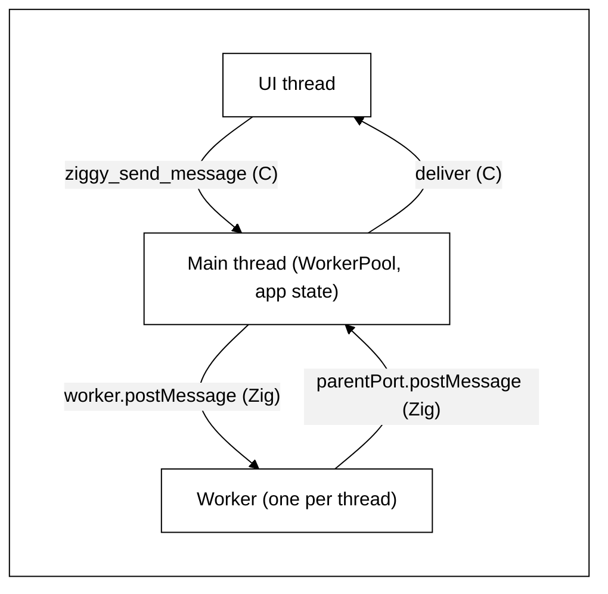
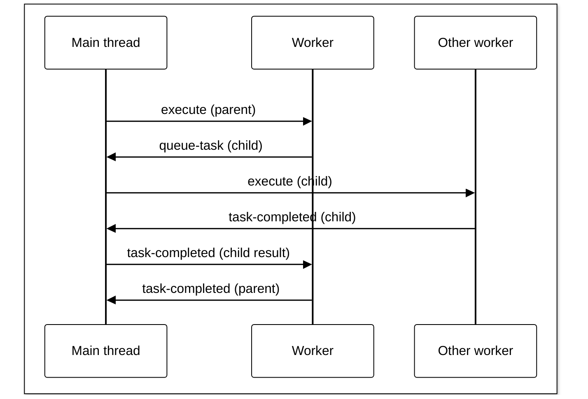

# Threads share nothing and talk in JSON messages

## Banned words

Never use these words or names in this plan, in the code it produces or in reports about it. Use the TypeScript name, the existing name in the code or a word that says what happens.

- ask, answer, say
- host, host request, host reply (except "dev host", the existing name of Ziggy's dev mode program)
- mailbox, inbox
- coordinator
- job (Photosphere's jobs are a separate frontend feature; the word here is task)
- notes (the word is messages)
- waiting (as a message or state name)
- frame, helper thread, tool thread, pump, drain, fan-out, actor
- today, currently (the plan describes only the end state)

## How it works

- The web page sends messages to the main thread. The main thread sends replies and events back to the page.
- The main thread keeps the list of tasks and the app's data. Only the main thread changes them.
- Each worker runs one task at a time and keeps its own data to itself.
- Threads send each other copies of JSON text. Nothing else is shared.

## Overview

After this plan, Ziggy, Photosphere, `ziggy-example-vite` and `ziggy-example-rsbuild` work as the TypeScript original does: every thread keeps its own state, no thread can reach another thread's memory and threads talk only by JSON messages. Ziggy's names follow the desktop app's `apps/desktop/src/lib/worker-pool-electron-main.ts`, `apps/desktop/src/worker.ts` and `apps/desktop/src/lib/worker-log-electron.ts`. The CLI's names follow `apps/cli/src/lib/worker-pool-bun.ts` and `apps/cli/worker.ts`. All are in the photosphere repository.

## Issues

1. [x] Photosphere does not build against the Ziggy checkout beside it. `build.zig.zon` pins Ziggy `v0.0.10` by git URL, as do `apps/photosphere-frontend/package.json`, the Xcode projects and `native/android/app/build.gradle`. Steps 13 to 21 cannot use the new Ziggy without a release or a change of dependency, and the plan has neither. Step 22's stop for a release comes after the Photosphere steps that already need it.
2. [ ] ~~No documentation step comes first with a stop for approval, and none comes last to match the final code. The plan changes a documented surface: `ziggy.h` (the rename, and the thread rules written on `deliver`, `keep_alive`, `host_request`, `pick_paths` and `ziggy_post_message`), `docs/user-guide/messages.md`, `tasks.md`, `menus.md`, `docs/development/architecture.md`, `dev-mode.md` and the native READMEs all name `registerMessage`, `registerTask` or `ziggy_post_message`. Nothing says later steps are revised if the human revises the docs.~~ We chose not to fix this.
3. [-] Step 3 has the main thread call the native app for each `native-app-request`. `ziggy.h` says `pick_paths` and `host_request` block until the user closes a dialog and "may take a long time", so for that whole time the main thread handles no messages, timers or task dispatch.
4. [x] Step 10 has Linux and Windows hand pick results back by message, but macOS, iOS and Android implement the same `pick_paths` and `host_request` callbacks and the plan does not say whether theirs change. No new C function to carry a result back is named.
5. [x] `native-app-request` and `native-app-response` do not exist in the TypeScript, so step 2's "laid out as TypeScript lays it out" gives them no fields.
6. [x] The TypeScript source is mixed. `IWorkerShutdownMessage` is only in the CLI's `worker-pool-bun.ts`. The `log` message is `IWorkerLogMessage` in desktop's `worker-log-electron.ts`. Desktop's `IWorkerShowNotificationMessage` is left out. Ziggy's TypeScript counterpart is `worker-pool-electron-main.ts`, yet the Overview names only the CLI files for Ziggy's names.
7. [x] `ziggy_files_dropped` returns a bool after checking the paths. Step 6 posts dropped files to the main thread, so the result is not known when the call returns, and the plan does not say what it returns.
8. [x] Shutdown is not covered: how `ziggy_destroy` stops the main thread, workers, timers and the test control thread, and what happens to a worker blocked on a `native-app-response` while the UI thread is inside `ziggy_destroy`.
9. [x] How a worker reads its own queue in the middle of a task is not described: `isCancelled` has to look at the queue without blocking, and messages that arrive while a task blocks on one child (another child's `task-completed`, `cancel-tasks`) have to be kept for later.
10. [x] The Verify grep matches code no step touches: `threadlocal var last_error` in Ziggy's `task-queue/utils/errors.zig` and Photosphere's `utils-zig/src/lib/errors.zig`, the atomics in `native/linux/src/lib/shell.zig`, the COM reference counts in `native/windows/src/lib/shell.zig`, `dev/src/lib/supervisor.zig`, `fake-shell.zig`, `message-registry.zig` and `dropped-files.zig`. No step removes them or allows them.
11. [x] `exec.zig` (Ziggy's `task-queue/utils/exec.zig` and Photosphere's `node-utils-zig/src/lib/exec.zig`) starts a thread to read stderr from inside a task, against step 17's "starts no threads of its own". The Verify grep does not look for `Thread.spawn`, so it will not catch this or any other new thread.
12. [x] Photosphere code with locks, atomics, thread-locals or threads that no step names: `apps/cli-zig/src/cmd/sync.zig`, `apps/cli-zig/src/lib/clack/core/utils/index.zig` (key-swallowing thread), `apps/cli-zig/src/lib/worker-log-bun.zig`, `photosphere-core/src/lib/background-work.zig`, `macos-host.zig`, `windows-host.zig`, `mcp-zig/src/lib/streamable-http.zig`, and in `storage-zig/src/lib/s3-client.zig` a per-call library lock, an error-name lock and a thread-local status code (step 18 covers only starting S3 once).
13. [x] Step 17 removes LAN share's threads, but `lan-share-receiver.zig` is a server with a server thread, a broadcast timer thread and a thread per connection. Step 15 gives the asset and MCP servers a pool of connection threads; nothing says how the LAN share receiver serves connections without threads.
14. [x] "After every step, `test:zig` passes" cannot hold as ordered. Step 1 builds `Worker` before step 2 defines the messages it carries. Step 4 removes `registerTask` and `registerHandler`, and step 6 removes `registerMessage`, which `dispatcher.test.zig`, `app.test.zig`, `registration.test.zig`, `task-queue.test.zig`, `worker.test.zig`, the template's `hello-world.test.zig` and the test app's `handlers.test.zig` call. Porting those tests is not a step.
15. [-] Step 8 does not say whether a task on a worker can call `setTimeout` (TypeScript workers can), nor how code reaches these functions (a global, a `Core` method, a context method).
16. [x] Step 15 does not give the connection thread limit or what happens when every thread is busy (queue the connection or refuse it).
17. [ ] ~~Step 15's Express-like framework writes a replacement for a third-party library. Photosphere's `CLAUDE.md` bans that unless the human explicitly asks, and Ziggy's `CLAUDE.md` says text in a plan is not approval. No approval is recorded.~~ We chose not to fix this.
18. [ ] ~~Step 17 turns work that ran side by side into child tasks a parent blocks on. With step 11's limit (a parent keeps its worker), more blocked parents make it likelier that every worker holds one and the queue stops. The slowdown step 17 accepts is not measured anywhere.~~ We chose not to fix this.
19. [x] Step 10's "check iOS, macOS and Android for shared state" has no defined outcome, and the plan's last line records that which native thread calls each Ziggy function is not confirmed.
20. [x] No tests are named for: a `native-app-request` round trip, `log` messages reaching the main thread's output, `ziggy_send_message` returning before the handler runs, dropped files reaching the main thread before the page's `getPathForFile`, `ziggy_destroy` with tasks in flight, cancelling a task blocked on a child, `clearTimeout` and `clearInterval`, the CLI pool's crash handling (step 19), the connection pool when full, the spinner's and signal watcher's messages, and Android's `sendMessage` rename.
21. [x] Photosphere's smoke suites are not listed under Smoke Tests, though steps 13 to 19 change its desktop, mobile and CLI apps.
22. [x] The Verify grep for Photosphere does not leave out `third-party/`, `tmp/` or `native/android/.gradle`, which hold many matches, so "finds nothing" cannot be read off its output.
23. [x] Security: step 15 does not state which address the asset server and MCP server listen on, and the connection limit that bounds how many threads a client can make the server start is not given (issue 16).
24. [x] Step 6's `ziggy_destroy` deadlocks while a file dialog is open on Linux. `destroyCore` in `native/linux/src/lib/shell.zig` calls `ziggy_destroy` on the GTK UI thread. Step 6 has `ziggy_destroy` block until the main thread ends, and lets "a native call the main thread is in the middle of" finish first. Linux's `pickPaths` queues the dialog with `g_idle_add` and blocks until the UI thread runs it, which cannot happen while the UI thread is inside `ziggy_destroy`. Windows has the same callback to check.
25. [-] ~~Step 13 commits a path to the local Ziggy checkout into Photosphere's and both examples' `build.zig.zon`, `package.json`, Xcode projects and Android build files. Their CI and any other clone have no Ziggy beside them, so every build there breaks. Ziggy's `CLAUDE.md` says the examples pin Ziggy to a version tag. No step moves them back to a tag, and the plan no longer stops for a Ziggy release.~~ We chose not to fix this.
26. [x] Step 13 switches Photosphere to the new Ziggy before steps 14 to 21 port it, but Photosphere's tests call `registerTask` and `registerMessage` (`asset-server.test.zig`, `main-process.test.zig`, `mcp-server.test.zig`, `pickers.test.zig`, `test-support.zig` and others). "`test:zig` passes after every step from then on" fails in Photosphere from step 13 until the port is done, and the plan does not say which repository's `test:zig` it means.
27. [x] Step 18's LAN share receiver "serves one connection at a time and sends its broadcast between them". The sender finds the receiver only by those UDP broadcasts (`lan-share-sender.zig`). While the receiver is blocked in `accept` no broadcast goes out, so a sender that missed the first one never finds it.
28. [x] Step 16 stops each server "on a message from the main thread, with no shared stop flag", but the server thread blocks in `accept` (`http-server.zig`) and reads no messages there. The plan does not say how a stop message reaches a thread blocked in `accept`, or a connection thread blocked on a read.
29. [x] Step 7 has Ziggy's `exec.zig` read a child's stdout and stderr on one thread with no thread of its own, and step 18 does the same to Photosphere's. Reading one pipe until it closes while the child fills the other blocks both processes. The plan does not say how both pipes are read on one thread.
30. [-] ~~The paragraph at the top of Steps ("runs to the end without stopping", "no questions", "keep trying other ways") goes against Ziggy's `CLAUDE.md`, which requires stopping to ask when a real library will not work, when a failure is outside the machine, when a test hook is needed or when an Android emulator is missing or broken. `test:smoke:ios` and Photosphere's `test:ziggy:ios` need a Mac, and this plan runs on Linux.~~ We chose not to fix this.
31. [x] The Notes line says step 11 is the only documentation step, but step 6 edits `ziggy.h` and the template's, both examples' and Photosphere's native READMEs.
32. [x] No tests are named for: `ziggy_destroy` while a file dialog is open, stopping each server by message, the LAN share receiver being found by a sender while it serves a connection, `exec.zig` with a child that writes a lot to both stdout and stderr, the keep-awake code on the main thread (step 14) and building Photosphere and the examples against the local Ziggy (step 13).
33. [-] ~~Security: the LAN share receiver listens on every address (`0.0.0.0`, `lan-share-receiver.zig`). Serving one connection at a time (step 18) lets any device on the LAN that opens a connection and sends nothing stop the transfer for everyone else.~~ We chose not to fix this.
34. [x] Step 6 has a file dialog return as cancelled when the native app is closing, so `ziggy_destroy` never blocks on the UI thread, but step 10 leaves the Swift and Java native apps unchanged. macOS's `ZiggyPicker.swift` signals a semaphore from `DispatchQueue.main` while the calling thread blocks, and `ZiggyBridge.swift` calls `ziggy_destroy`, so macOS keeps the deadlock issue 24 found on Linux. iOS and Android are not checked. The plan also does not say how the Linux and Windows picker callbacks learn the app is closing without a flag shared with the UI thread, which the Verify grep allows only for delivery queues and COM reference counts.
35. [x] Step 7 reads both pipes "with `poll`", but `exec.zig` has its own Windows path (`runCmdExe`, Windows pipe handles) and `poll` does not work on Windows pipes. The plan does not say how Windows reads both pipes on one thread.
36. [x] Step 16 says a connection thread "closes a connection that sends nothing", but the MCP server's `GET /mcp` (`streamable-http.zig`) holds a server-sent events stream open on which the client sends nothing after its request. Those streams end on a shared `stopping` flag (its own comment says a thread blocked on a connection cannot be woken). Step 16 removes shared stop flags and gives stop messages only to the server thread, so how a held-open stream ends on stop is not covered.
37. [x] Step 16 does not say how the main thread's `mcp-tool-response` reaches the connection thread holding that tool call. The server thread reads its messages only when its accept timeout passes, and connection threads share nothing, so no route from the server thread to a given connection thread is described.
38. [x] Step 16's "the MCP server sends tool calls to the page itself" does not say how. Every other message to the page goes through the main thread (How it works), and Ziggy's `deliver` belongs to the main thread after step 6.
39. [x] Step 16 and step 18 give no value for any of the new timeouts: the accept timeout (how late a stop or a LAN share broadcast can be), the read timeout that closes a silent connection, and the LAN share receiver's.
40. [x] The Unit Tests list puts two Ziggy items under Photosphere (`ziggy_destroy` with a file dialog open) and lists a build (Photosphere and the examples building against the local Ziggy) as a unit test. The test of `ziggy_destroy` with a dialog open needs the real native app, so it cannot be a unit test, and no smoke suite names it.
41. [-] ~~Security: closing a connection that sends nothing (steps 16 and 18) does not stop one that sends a byte just inside each timeout. On the LAN share receiver, which listens on every address and serves one connection at a time, any device on the LAN can still hold it that way.~~ We chose not to fix this.

## Steps

This plan runs to the end without stopping. Once implementation begins, there are no questions and no requests for decisions. If anything blocks progress, keep trying other ways until it is unblocked, then carry on until every step is done. Work only in the local checkouts of Ziggy, Photosphere and the two examples.

Run commands with `mise exec -- bun run <script>`. Steps 1 to 6 replace Ziggy's task system as one piece: Ziggy's `test:zig` passes after step 6 and after every later Ziggy step. Steps 13 to 20 port Photosphere as one piece, including its tests that call `registerTask` or `registerMessage`: Photosphere's `test:zig` passes after step 20. Watch each new test fail once before accepting it.

### Ziggy (`github.com/ashleydavis/ziggy`)

1. **Message types.** Add `IWorkerMessage`, `IWorkerCancelTasksMessage`, `IWorkerShutdownMessage`, `IWorkerReadyMessage`, `IWorkerTaskCompletedMessage`, `IWorkerTaskMessage`, `IWorkerQueueTaskMessage`, `IWorkerLogMessage`, `native-app-request` and `native-app-response`. Each one TypeScript has is laid out as the TypeScript one is. `native-app-request` carries a request id, the native function to call and its JSON input. `native-app-response` carries the same request id and the JSON result or the error. Desktop's `IWorkerShowNotificationMessage` is left out: no Zig task shows a notification.
2. **Workers.** Add `Worker`, `worker.postMessage` and `onmessage` for the main side. Add `initWorker`, `executeTask`, `parentPort.postMessage` and `onmessage` for the worker side. The queue that carries messages is the only place a lock may appear.
3. **Task context.** A running task sends events, queues and waits on children and checks for cancel only by message. `isCancelled` takes the messages already in the worker's queue without waiting. While a task waits on one child, any other message that arrives (another child's `task-completed`, `cancel-tasks`) is kept in arrival order and handled when the task next looks. A task makes requests to the native app only by message: a task that needs the native app to do something, such as show a file picker, sends `native-app-request` to the main thread, which calls the native app and sends the result back as `native-app-response`.
4. **`WorkerPool`.** The main thread owns the task list, an `IWorkerState` per worker, `handleWorkerMessage`, `dispatchTask` and `tryDispatchPending`. Task types come only from the app's `.tasks` list: remove `Core.registerTask` and `registerHandler`. Port every test that calls them to the app declaration.
5. **Task-queue package.** Port the TypeScript `WorkerQueueBackend`, which sends a task's child tasks to the main thread as `queue-task` messages. Remove the package's process-wide backend, its process-wide handler list and its locks. The mock worker pool that tests use runs tasks on real `Worker`s that talk by message.
6. **Main thread.** Ziggy starts a main thread, separate from the native app's UI thread, that owns all of the core's changing state, including the message handlers and the dropped files (remove their locks). Calls from the native app and replies a handler sends later are posted to it. `ziggy_send_message` passes the web page's message to the main thread and returns at once. The handler runs later, on the main thread. `ziggy_files_dropped` checks the paths on the calling thread, returns that result and posts the paths to the main thread. Remove `Core.registerMessage`: message handlers come only from the app declaration, as task types and menus do. Port every test that calls it. The C function `ziggy_post_message` is renamed `ziggy_send_message`, to match the page's `send`, in Ziggy's header, every caller (Ziggy's native apps and the dev host), Android's Java method `ZiggyNative.postMessage` (renamed `sendMessage`) and every README that names it (the template's, both example apps' and Photosphere's native apps'). `ziggy_destroy` posts a stop to the main thread and waits for it: the main thread clears its timers, sends `IWorkerShutdownMessage` to every worker, stops test control and waits for all of them to end. A native call the main thread is in the middle of finishes first. Every native app closes any open file dialog on its UI thread before it calls `ziggy_destroy`, so a waiting pick returns as cancelled and `ziggy_destroy` never waits on the UI thread it was called from.
7. **Logs and globals.** Remove the shared log, console and environment globals. A worker logs by sending an `IWorkerLogMessage`. Only the main thread writes stdout, stderr and log files. Ziggy's `exec.zig` reads a child process's stdout and stderr on the calling thread, with no thread of its own, by waiting on both pipes at once and reading whichever has data: `poll` on Linux, macOS and Android, overlapped reads waited on together on Windows.
8. **Timers.** Add `setTimeout`, `clearTimeout`, `setInterval` and `clearInterval`, whose callbacks run on the main thread. The main thread's wait for messages times out when the next one is due.
9. **Test app and test control.** The test app's media server task stops on cancel without a thread that watches for it. Test-control's threads share no state with the main thread and exchange messages with it.
10. **Native apps and dev host.** In the Linux and Windows native apps (Zig), the UI thread hands pick and screenshot results back to the waiting thread by message. The dev host's threads share no state. The Swift and Java native apps change only for the `sendMessage` rename and closing an open file dialog before `ziggy_destroy` (step 6).
11. **Task queue design doc.** In `docs/development/diagrams/task-queue.md` (and `docs/user-guide/tasks.md` where it covers the same ground), record that a task waiting on its child tasks keeps its worker, so if every worker holds a waiting parent the queue stops until a task times out, as in TypeScript. Note it is not a problem in practice and may have to be addressed later.
12. **Check Ziggy.** Run the grep from Verify and the Ziggy smoke suites.
13. **Point Photosphere and the examples at this Ziggy.** Every Ziggy dependency in Photosphere and both examples (`build.zig.zon`, the frontend `package.json`, the Xcode projects and the Android build files) points at the local Ziggy checkout beside it.

### Photosphere (`github.com/ashleydavis/photosphere`)

14. **App state on the main thread.** Remove the global app state and every way a task reaches it. Photosphere's node-api task types move into its `.tasks` list. Remove the timer thread: its timers become `setTimeout` and `setInterval` calls, as in the TypeScript app. The macOS and Windows keep-awake code runs only on the main thread: remove its locks.
15. **Tasks stop touching app state.** A task gets its inputs in its data and sends results back as events or its result. The main thread applies them.
16. **Asset server and MCP server.** These are Photosphere's own threads and have nothing to do with Ziggy. Extend Photosphere's existing HTTP server (`http-server.zig`, which both servers already use) into a small Express-like framework for Zig: routes by method and path, with request and response helpers. It has only what these two servers need. The server thread accepts connections and hands each to a connection thread from a pool that starts one thread up front, starts more as connections arrive up to a limit and reuses them after that. The limit is passed in by each server. When every thread is busy, a new connection waits until one is free. A connection thread keeps its own state and shares nothing with the others. Each server owns its sockets and state (asset storage, pending MCP tool calls), keeps listening only on the loopback address as it does now and stops on a message from the main thread, with no shared stop flag. The server thread waits for a connection with a timeout of about a second and reads its messages each time the timeout passes. Each connection thread has its own message queue that the server thread posts to. It reads with the same timeout so it sees its messages, including stop. A held-open MCP event stream ends when its connection thread gets stop. The main thread opens the asset server's socket before starting it, so it knows the port without a message. The MCP server sends tool calls to the page itself through the native app's `deliver`, which any thread may call. The main thread passes the page's `mcp-tool-response` on to the MCP server thread as a JSON message. The server thread keeps which connection thread holds each tool call and posts the response to it.
17. **Logging.** Log files belong to the main thread. Remove the logger's locks, queue and writer threads. Remove the CLI's shared worker log routing.
18. **Shared state in tasks.** Remove locks, caches and extra threads from media sources, hash cache, asset serving, LAN share, cached storage, import, encrypt, decrypt, building the file tree, prefetch, retry, the debounce and Photosphere's `exec.zig`. A task runs only on its own worker thread and starts no threads of its own, as in TypeScript. Work that could run side by side runs as child tasks or one piece after another, which may be slower. The LAN share receiver serves one connection at a time on its task's thread. It waits for a connection with its existing broadcast interval as the timeout and sends its broadcast each time the timeout passes. Photosphere's `exec.zig` reads both pipes the same way as Ziggy's.
19. **Shared libraries.** Vaults per task. S3 and Winsock start once on the main thread. Remove S3's per-call library lock and its error-name lock. ffmpeg and ImageMagick are libraries each task calls on its own thread: remove the locks around them. The CLI spinner thread and the CLI's key-swallowing thread are Photosphere's own: each keeps its own state and gets its messages from the main thread, with no shared fields or lock. The CLI's signal watcher thread sends a message to the main thread, which runs the signal callbacks, including stopping `sync --watch`.
20. **CLI worker pool.** Rewrite it as a port of the TypeScript `WorkerPoolBun`, keeping its crash handling.
21. **Tests with globals.** Test helpers build their state per test.
22. **Check Photosphere.** Run the grep from Verify and `tev`.

### Example apps (`ziggy-example-vite`, `ziggy-example-rsbuild`)

23. **Examples on the new Ziggy.** Carry over the template's changes to each example and run its full test set.

## Unit Tests

- Every changed function gets a unit test.
- Each port of an existing test asserts what it asserted.
- Messages: order kept, none lost, each encodes to the JSON the TypeScript sends.
- `WorkerPool`: each message type, cancel, cancelling a task that waits on a child.
- Main thread: handlers, timers, `clearTimeout`, `clearInterval` and dropped files run there. `ziggy_send_message` returns before the handler runs. Dropped files reach the main thread before the page's `getPathForFile` message. `ziggy_destroy` with tasks in flight stops every thread.
- Worker logs reach the main thread's output. A `native-app-request` gets its `native-app-response`.
- Photosphere: the main thread applies each value a task now reports. The keep-awake code runs on the main thread. Each server stops on its message. A sender finds the LAN share receiver while it serves a connection. `exec.zig` handles a child that writes a lot to both stdout and stderr. The HTTP framework starts one connection thread up front, adds threads up to the limit, reuses them after it and holds a connection while every thread is busy. The asset server starts on a port the main thread chose; MCP tool calls reach the page and responses reach the MCP server. The CLI pool replaces a crashed worker. The spinner, key-swallowing and signal watcher threads get their messages.

## Smoke Tests

- Ziggy: `test:smoke`, `test:smoke:dev`, `test:smoke:android` (covers the `sendMessage` rename) and `test:smoke:ios` (on a Mac) pass unchanged. Add a desktop smoke test that closes the app while a file dialog is open and checks it exits.
- Photosphere: `test:cli:zig`, `test:ziggy`, `test:ziggy:and` and `test:ziggy:ios` (on a Mac), all run by `tev`.
- Examples: `test:smoke` and the mobile suites.

## Verify

- `compile` and `test:zig` pass in each repository. Photosphere and both examples build against the local Ziggy.
- The smoke suites above pass.
- Photosphere `tev` exits 0.
- `grep -rnE 'Mutex|Condition|RwLock|std\.atomic|Thread\.spawn|\.concurrent\(|Io\.Group' --include='*.zig' --exclude-dir=.zig-cache --exclude-dir=zig-pkg --exclude-dir=.claude --exclude-dir=node_modules --exclude-dir=third-party --exclude-dir=tmp --exclude-dir=.gradle .` finds nothing outside: the message queue, the HTTP framework's pool, the threads Ziggy and Photosphere start on purpose (workers, main thread, servers, spinner, key swallowing, signal watcher, test control, dev host), the Linux and Windows native apps' delivery queues and COM reference counts, the dev supervisor (a separate process) and test-only code. Thread-local values are allowed: each thread has its own.

## Notes

- Step 11 is the only step that writes documentation, at the human's request. Step 6 also carries the `ziggy_send_message` rename into `ziggy.h` and the native READMEs.
