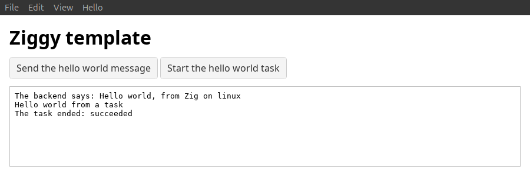

# Quick start

The quickest way to see Ziggy working is to setup, build and run the desktop build of the example app. 

This quick start is for Linux, Windows and MacOS, but has only been tested on Linux. If you have feedback on the other platforms please log an issue or submit a PR.

Check the [glossary](glossary.md) to understand the jargon.

## 1. Install the tools

Install the dependencies for your platform: [Dependencies](user-guide/dependencies.md#installing-them).

## 2. Get the example

```bash
git clone https://github.com/ashleydavis/ziggy-example-vite.git
cd ziggy-example-vite
mise trust
mise install
bun install
```

### Other examples:

- [Rsbuild example](https://github.com/ashleydavis/ziggy-example-rsbuild): the frontend built with Rsbuild.

## 3. Set up

### Windows

Run `bun run setup`. It downloads the WebView2 SDK and installs Microsoft's C++ build tools. 

### Linux, MacOS

For desktop builds you need nothing else, If you want to run it on Android or iOS run `bun run setup`. It installs the Android SDK, NDK and JDK, and on a Mac checks Xcode for iOS.

## 4. Run it

Run the command for your platform:

```bash
bun run linux
bun run windows
bun run macos
```

This builds the app and opens its window:



## 5. Test it

Run the automated tests:

```bash
bun run compile     # Type-checks the frontend.
bun run test        # Runs the frontend's unit tests.
bun run test:zig    # Builds the backend and runs its unit tests.
bun run test:smoke  # Builds the app and runs its smoke tests in a hidden window.
```

## 6. See how it works

The app is declared and sets message handlers, background tasks and menu ([`backend/src/app.zig`](../apps/ziggy-template/backend/src/app.zig)):

```zig
pub const app = ziggy.core.App(.{
    // Handlers for messages from the frontend.
    .messages = .{
        .@"hello-world" = hello_world.helloWorldHandler,
    },

    // Handlers for background tasks requested by backend and frontend.
    .tasks = .{
        .@"hello-world-task" = hello_world.helloWorldTaskHandler,
    },

    // The desktop menu, declared in backend/src/lib/menu.zig.
    .menu = menu.menu,
    ...
});
```

### Sending and handling messages

When the "Send the hello world message" button is pressed, the app sends the backend a message named `hello-world` and writes the response it gets back to its log. The code in this section is the Ziggy template's ([`frontend/src/main.ts`](../apps/ziggy-template/frontend/src/main.ts)):

```ts
//
// Sends the backend the hello-world message when its button is pressed.
//
function listenForTheMessageButton(): void {
    element("send-message").addEventListener("click", async () => {
        try {
            // Sends a message to the backend.
            const response = await window.ziggy.invoke<IHelloWorldResponse>("hello-world", {
                name: "world",
            });
            log(greetingLine(response));
        }
        catch (error) {
            // The message failed: log the error's message.
            log(`The backend did not answer: ${(error as Error).message}`);
        }
    });
}
```

A Zig function in the backend, the message's handler, gets the message's data parsed into a struct of its own and returns the response, which Ziggy sends back as JSON ([`backend/src/lib/hello-world.zig`](../apps/ziggy-template/backend/src/lib/hello-world.zig)):

```zig
//
// The data of the frontend's hello-world message.
//
pub const HelloWorldRequest = struct {
    // Who to greet.
    name: []const u8,
};

//
// The message response to the hello-world message.
//
pub const HelloWorldResponse = struct {
    // The greeting, naming the platform the app runs on.
    greeting: []const u8,
};

//
// Handles the frontend's hello-world message.
//
pub fn helloWorldHandler(core: *ziggy.core.Core, arena: std.mem.Allocator, request: HelloWorldRequest) !HelloWorldResponse {
    _ = core;

    //
    // Sends the response back to the frontend.
    //
    return .{
        .greeting = try std.fmt.allocPrint(arena, "Hello {s}, from Zig on {s}", .{
            request.name,
            @tagName(builtin.os.tag),
        }),
    };
}
```

### Running background tasks

Slower work should be sent to the backend as a background task so that it doesn't block the main thread or the frontend.

The frontend queues a task when the "Start the hello world task" button is pressed. It then logs the task's events and the task completion ([`frontend/src/main.ts`](../apps/ziggy-template/frontend/src/main.ts)):

```ts
//
// Starts the hello-world task when its button is pressed, and logs what the task sends and how it ends.
//
function listenForTheTask(): void {
    // Numbers the tasks, so each one gets an id of its own.
    let nextTaskNumber = 1;
    element("start-task").addEventListener("click", () => {
        // The hello-world task takes no input.
        const data: IJsonValue = null;

        // Queues the task, which the backend runs on a worker thread. This returns straight away.
        window.ziggy.addTask({
            taskId: `hello-world-task-${nextTaskNumber++}`,
            taskType: "hello-world-task",
            source: "hello-world",
            data,
            priority: "interactive",
        });
    });

    // Logs each event a task sends while it runs.
    window.ziggy.onTaskEvent<IOutputEvent>(event => {
        log(event.data.text);
    });

    // Logs how each task ended.
    window.ziggy.onTaskCompleted(event => {
        log(`The task ended: ${event.result.status}`);
    });
}
```

A Zig function runs the task on a worker thread, sends the frontend an event and completes with a result ([`backend/src/lib/hello-world.zig`](../apps/ziggy-template/backend/src/lib/hello-world.zig)):

```zig
//
// The hello-world task: sends the frontend one output event while it runs, then completes with a result.
//
pub fn helloWorldTaskHandler(context: *TaskContext, data: std.json.Value) anyerror!?[]const u8 {
    _ = data;

    //
    // Sends the frontend an event while the task runs.
    //
    try context.sendEvent(.{
        .type = "output",
        .text = "Hello world from a task",
    });

    //
    // Completes with a result for the frontend.
    //
    return try context.arena.dupe(u8, "\"hello world task done\"");
}
```

### Using the menu

The Hello menu has two items. Choosing "Say Hello From Zig" runs a Zig function in the backend, which sends the frontend an event. Choosing "Say Hello From the UI" runs no Zig: it reaches the frontend as the menu event `{"type": "menu", "item": "hello-from-ui"}`. Both are declared in the app's menu ([`backend/src/lib/menu.zig`](../apps/ziggy-template/backend/src/lib/menu.zig)):

```zig
pub const menu: []const ziggy.menu.Menu = &.{
    ...
    .{
        .label = "Hello",
        .items = &.{
            // This menu runs a Zig function in the backend.
            .{
                .label = "Say Hello From Zig",
                .name = "hello-from-zig",
                .run = .{
                    .zig = hello_world.helloFromZigMenuItem,
                },
            },
            // This menu sends a message to the frontend.
            .{
                .label = "Say Hello From the UI",
                .name = "hello-from-ui",
                .run = .ui,
            },
        },
    },
};
```

The Zig function sends the frontend an event of its own ([`backend/src/lib/hello-world.zig`](../apps/ziggy-template/backend/src/lib/hello-world.zig)):

```zig
//
// Runs when "Say Hello From Zig" is chosen. Sends the frontend an event to log.
//
pub fn helloFromZigMenuItem(core: *ziggy.core.Core, arena: std.mem.Allocator) !void {
    try core.sendEvent(arena, "{\"type\":\"hello-from-zig\",\"text\":\"Hello from Zig, run from the menu\"}");
}
```

The frontend listens for both events and logs a line for each ([`frontend/src/main.ts`](../apps/ziggy-template/frontend/src/main.ts)):

```ts
//
// Logs what the Hello menu's items lead to: the event Say Hello From Zig's Zig function sends, and the menu event Say Hello From
// the UI reaches the frontend as.
//
function listenForTheMenu(): void {
    window.ziggy.onEvent<IAppEvent>(event => {
        const line = logLineForEvent(event);
        if (line !== null) {
            log(line);
        }
    });
}
```

`logLineForEvent` picks the line: the text the Zig function sent, or a fixed line for the menu event ([`frontend/src/lib/hello-world.ts`](../apps/ziggy-template/frontend/src/lib/hello-world.ts)):

```ts
//
// The line the frontend logs for an app event from the Hello menu, or null when the event is not one it logs.
//
export function logLineForEvent(event: IAppEvent): string | null {
    if (event.type === "hello-from-zig") {
        return event.text;
    }
    if (event.type === "menu" && event.item === "hello-from-ui") {
        return "Hello from the UI, run from the menu";
    }
    return null;
}
```

For the rest of what a menu can do (standard actions, shortcuts and platforms), see [Menus](user-guide/menus.md).

### Try a change

Change `name: "world"` in `frontend/src/main.ts`, or the greeting text in `helloWorldHandler`, then run the same `bun run <platform>` again and press "Send the hello world message" to see it change.

## Next

- To change the frontend and see it update as you save, run `bun run dev` and see [Dev mode](user-guide/dev-mode.md).
- To create your own app, see [Building your app](user-guide/building-your-app.md#starting-a-new-app-from-the-template).
