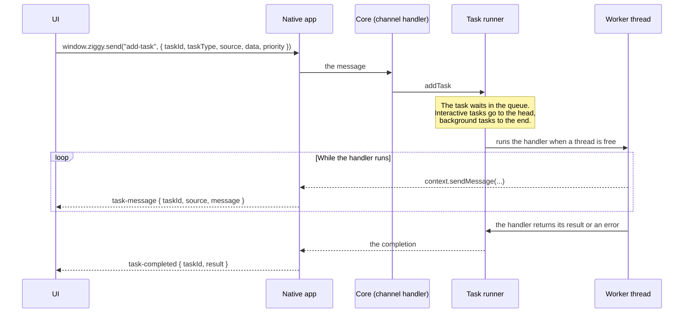

# Tasks

A task is work the core runs on its own pool of worker threads, away from the thread that handles the UI's messages. Anything slow (reading files, hashing, talking to the network, waiting on the user in a native dialog) is a task. A task can report progress while it runs, queue child tasks and be cancelled. See the [glossary](../README.md#glossary) for "the UI", "the core" and "the native app".

## How it works



- The UI makes up the task's id and names a source. The source groups tasks so they can be cancelled together.
- There is one queue. An interactive task goes at the head of it and a background task at the end. A task with no priority runs as background.
- The native app sets the number of worker threads and the limit on child tasks in flight when it creates the core (`ziggy_create`).
- A task that is cancelled ends as failed, with the error message `Cancelled`.

## Writing a handler

A handler is a Zig function that takes the task's context and the data the UI queued it with, and returns the JSON text of its result, or null for none. Returning an error fails the task. The error message is the error's name, unless the app sets `describe_error` to a function that describes it.

```zig
const std = @import("std");
const ziggy = @import("ziggy");

const TaskContext = ziggy.task_runner.TaskContext;

pub fn helloShortHandler(context: *TaskContext, data: std.json.Value) anyerror!?[]const u8 {
    _ = data;
    try context.sendMessage(.{
        .type = "output",
        .text = "hello from a short task",
    });
    return try context.arena.dupe(u8, "\"short task done\"");
}
```

Allocate from `context.arena`. It lives as long as the task.

What the context gives a handler:

| Method | What it does |
|---|---|
| `sendMessage(value)` | Sends any value `std.json` can serialise to the UI as a `task-message` event. `sendRawMessage(json)` sends JSON text. |
| `isCancelled()` | Whether the task's source has been cancelled. |
| `checkCancelled()` | Returns `error.Cancelled` when the source has been cancelled. Call it at the top of every loop. |
| `queueChild(type, data, priority)` | Queues a child task and returns its id. It waits while the child limit is reached. |
| `awaitTask(child_id)` | Waits for one child and returns how it ended. A failed child is returned as a failure. |
| `awaitAllTasks()` | Waits for every child of this task. |
| `runChild(allocator, type, data, priority)` | Runs one child to its end and frees it, for a task that runs children one after another for as long as it lives. |
| `io()` | The `std.Io` for sleeping and file access. |
| `config()` | The configuration the native app gave the core, including its host callbacks and the app's data directory. |
| `appState()` | The app's own state, when it keeps any. |

## Registering a handler

The app lists its task types in the `tasks` field of the app it hands to Ziggy, in `core/src/handlers.zig` in the example:

```zig
.tasks = &[_]ziggy.task_runner.TaskHandlerEntry{
    .{
        .name = "hello-short",
        .handler = hello_tasks.helloShortHandler,
    },
    .{
        .name = "background-keep-alive",
        .handler = hello_tasks.backgroundCountHandler,
        .kind = .keep_alive,
    },
},
```

- `name` is the task type the UI queues it under.
- `kind` is `.normal` by default. A `.keep_alive` task keeps the app running on a phone while it is in the background. See [Keep-alive tasks](architecture.md#keep-alive-tasks).
- A task type that nothing is registered for fails as `UnknownTaskType`.

## Queuing a task from the UI

```typescript
window.ziggy.send("add-task", {
    taskId: "hello-short-1",
    taskType: "hello-short",
    source: "my-source",
    data: {},
    priority: "background",
});
```

- `taskId`: made up by the UI. The task's events carry it, so the UI can tell which task they belong to.
- `taskType`: the name the handler was registered under.
- `source`: the group the task belongs to, for cancelling.
- `data`: any JSON. It is the handler's `data`.
- `priority`: `"interactive"` for something the user is waiting on, `"background"` for everything else. Leave it out for background.

## Receiving the events

```typescript
window.ziggy.onMessage("task-message", event => {
    // event.taskId, event.source, and event.message (what the handler sent)
});

window.ziggy.onMessage("task-completed", event => {
    // event.taskId, and event.result:
    //   status: "succeeded" or "failed"
    //   errorMessage: why it failed ("Cancelled" for a cancelled task)
    //   outputs: what the handler returned
    //   type: the task type
    //   inputs: the data the task was queued with
});
```

Every message a handler sends arrives as one `task-message` event. The example gives each message a `type` field (`"output"`, `"job-progress"`) and the UI decides what to do with it from that. Ziggy does not look inside a message.

## Cancelling

```typescript
window.ziggy.send("cancel-tasks", "my-source");
```

Cancelling a source cancels its queued and running tasks, children included. A running task stops only when its handler next calls `checkCancelled()` or `isCancelled()`, so a handler that loops must check at every step.

## Child tasks

A handler can split its work into child tasks with `queueChild` and wait for them with `awaitTask` or `awaitAllTasks`. The example's `hello-long` does this in `core/src/lib/hello-tasks.zig`.

- Children run on the same pool as their parent. A parent that waits gives up its worker thread while it waits, so the pool cannot deadlock when every thread is held by a waiting parent.
- A child runs at the priority it asks for, and otherwise at its parent's.
- A failed child makes `awaitTask` return its failure to the parent.

## A request answered by a task

A request the UI sends with `window.ziggy.invoke` is answered by a channel handler on the thread that handles the UI's messages, so it must be quick. When the answer takes time, list the channel in the app's `task_channels` instead: the request is queued as a task of that type, with the request's data as its input, and the task's result is the reply. A task that fails or is cancelled gives an error reply. The example's file and folder pickers work this way, because they wait on a native dialog.

```zig
.task_channels = &[_]ziggy.core.TaskChannelEntry{
    .{
        .name = "pick-folder",
        .task_type = "pick-folder",
    },
},
```

## Key files

| File | What it holds |
|---|---|
| `packages/ziggy/core/src/lib/task-runner.zig` | The task runner, `TaskContext`, `TaskHandlerEntry`, `TaskPriority` and `TaskKind`. |
| `packages/ziggy/core/src/lib/core.zig` | The `add-task` and `cancel-tasks` channels, and `TaskChannelEntry`. |
| `packages/ziggy/task-queue` | The `task-queue` module the core implements its queue backend for. See [Task queue interfaces](architecture.md#task-queue-interfaces). |
| `apps/ziggy-example/core/src/lib/hello-tasks.zig` | The example's task handlers. |
| `apps/ziggy-example/ui/src/main.ts` | How the example's UI queues tasks and handles their events. |
