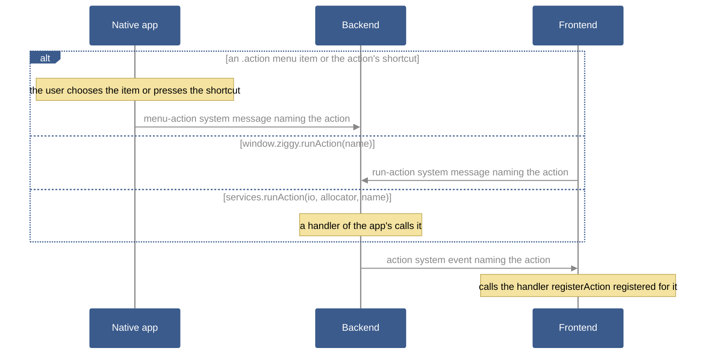

# Actions

Terms are defined in the [glossary](../glossary.md).

An action is a named piece of an app's functionality that takes no arguments, such as "Open Database". The backend declares each action with a name, a label and an optional keyboard shortcut, and the frontend registers its handler. A menu item, the shortcut, the frontend and the backend can all run the action by its name, and each of them runs the same handler.

Unlike a task, an action takes no input and runs in the frontend, not on a backend worker thread (see [Tasks](tasks.md)). A handler that needs work done in the backend sends a message with `invoke` (see [Messages](messages.md)) or queues a task with `addTask`.

## How it works



## Declaring the actions

The backend passes its actions to `ziggy.core.App` as `.actions`, which is optional (see [The app declaration](app-declaration.md)). The template's are in [`backend/src/lib/actions.zig`](../../apps/ziggy-template/backend/src/lib/actions.zig):

```zig
pub const actions: []const ziggy.action.Action = &.{
    .{
        .name = "hello-from-action",
        .label = "Say Hello From an Action",
        .shortcut = "CmdOrCtrl+Shift+H",
    },
};
```

Each `name` must be unique. A menu item runs an action when its `run` is `.action` (see [An action of the app's](menus.md#an-action-of-the-apps)).

## Registering a handler

The frontend registers each handler with `window.ziggy.registerAction`. A handler takes no arguments and may return a promise. If it throws or its promise rejects, Ziggy writes the error and its stack trace to the app's log as an exception, naming the action (see [Logging](logging.md)).

The template's, in [`frontend/src/main.ts`](../../apps/ziggy-template/frontend/src/main.ts):

```ts
function helloFromAction(): void {
    log("Hello from an action");
}

function registerActions(): void {
    window.ziggy.registerAction("hello-from-action", helloFromAction);
}
```

## Running an action

Four things run an action by its name:

- **A menu item** of the `.action` kind (see [Menus](menus.md#an-action-of-the-apps)).
- **The action's keyboard shortcut**, which works whether or not the action is on the menu (see [Keyboard shortcuts](menus.md#keyboard-shortcuts) for the syntax).
- **The frontend**, by calling `window.ziggy.runAction(name)`, as the template's "Say hello from an action" button does:

  ```ts
  window.ziggy.runAction("hello-from-action");
  ```

- **The backend**, by calling the handler services' `runAction(io, allocator, name)` (see [The app declaration](app-declaration.md#handler-arguments)).

`runAction` can also run a standard action, such as `zoom-in`, when the app's menu has a `.standard` item for it.

`runAction` fails with one of these errors, and `window.ziggy.runAction` rejects with an `Error` whose message is the error's name:

- `UnknownAction`: the name is neither one of the app's actions nor a standard action on the app's menu.
- `StandardActionUnavailable`: the name is a standard action on the app's menu, but the app is on a phone or in dev mode, where standard actions cannot run.

## Listing the actions

`window.ziggy.listActions()` resolves with every action of the app and every `.standard` item of its menu, as `IActionInfo` objects:

- `name`: the name of the action or standard action, such as `zoom-in`.
- `label`: the label of the action or `.standard` item.
- `shortcut`: the shortcut as the platform shows it, such as `Ctrl+Shift+H` on Linux and Windows or `⇧⌘H` on macOS. It is null when there is none and on a phone.

An app can build its own command palette from this list and run the chosen entry with `runAction`.

## On each platform

- **iOS and Android:** no menu and no shortcuts. Actions run only through `runAction`.
- **Dev mode:** there is no menu, but action shortcuts work in the browser, except those the browser keeps for itself, such as Ctrl+W and Ctrl+T (see [Dev mode](dev-mode.md)).
- **Linux, Windows and macOS:** the template's File > New Window item runs an action whose handler opens another window of the app (see [New windows](new-windows.md)).

## Testing actions

A smoke test runs the action as a user would. The template's [`smoke-tests/hello-world-app/test.sh`](../../apps/ziggy-template/smoke-tests/hello-world-app/test.sh) presses the button that calls `runAction`, on every platform including phones:

```bash
click run-hello-action
wait_for_text log "Hello from an action" 30
```

and [`smoke-tests/desktop-only/hello-menu/test.sh`](../../apps/ziggy-template/smoke-tests/desktop-only/hello-menu/test.sh) chooses the menu item, on desktop platforms only:

```bash
choose_menu_item hello-from-action
wait_for_text log "Hello from an action" 30
```

## See also

- [Menus](menus.md): the `.action` item and the shortcut syntax.
- [Messages](messages.md#ziggys-own-calls): Ziggy's own calls on `window.ziggy`.
- [The app declaration](app-declaration.md): the `.actions` field and the handler services' `runAction`.
