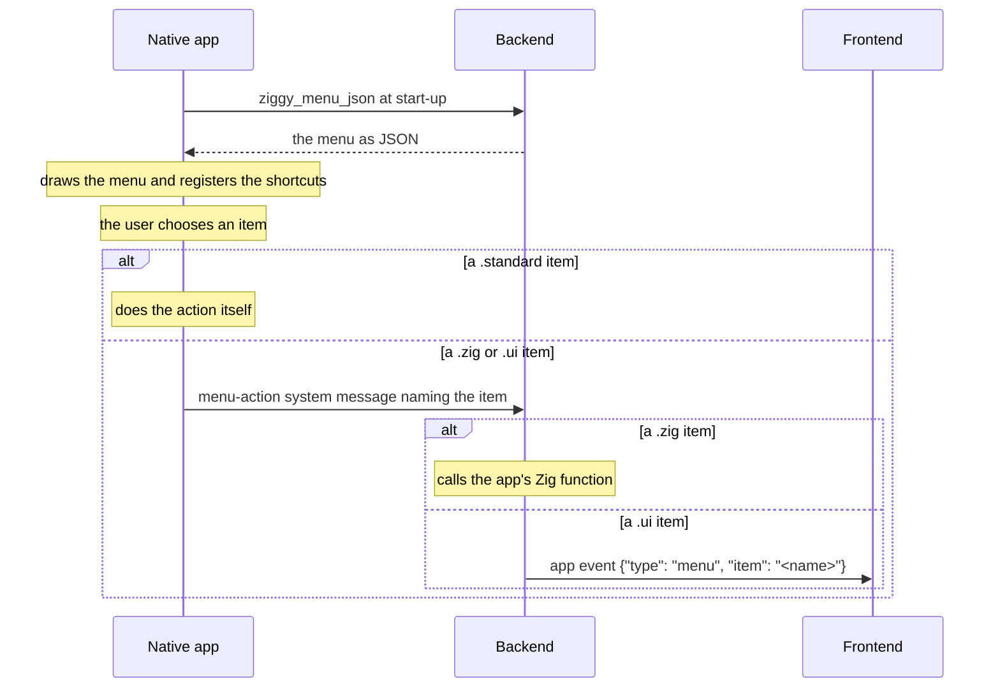

# Menus

Terms are defined in the [glossary](../glossary.md).

An app's desktop menu is declared once, in the backend, as a Zig constant. When the app is built, Ziggy checks it and turns it into JSON text that each desktop native app reads at start-up and draws with the platform's own menu API. When the user chooses an item, or presses its shortcut, the item runs one of three things: an action the native app does itself (such as quit, zoom or copy), a Zig function of the app's or the frontend, which receives it as an app event. A mobile device shows no menu.

## How it works



The menu is fixed when the app is built. There is no call to change it, add items to it or enable, disable or check an item while the app runs.

## Declaring the menu

The menu is a `[]const ziggy.menu.Menu`, passed to `ziggy.core.App` as `.menu`. The field is required: an app with no menu passes `&.{}`. The template's menu is in [`backend/src/lib/menu.zig`](../../apps/ziggy-template/backend/src/lib/menu.zig) and its [`backend/src/app.zig`](../../apps/ziggy-template/backend/src/app.zig) passes it on:

```zig
const menu = @import("lib/menu.zig");
```

```zig
    .menu = menu.menu,
```

Each `ziggy.menu.Menu` is one menu of the menu bar, with a `label` and its `items`. The start of the template's:

```zig
pub const menu: []const ziggy.menu.Menu = &.{
    .{
        .label = "File",
        .items = &.{
            .{
                .label = "Close Window",
                .accelerator = "CmdOrCtrl+W",
                .run = .{
                    .standard = .@"close-window",
                },
            },
            .{
                .label = "Quit",
                .accelerator = "CmdOrCtrl+Q",
                .run = .{
                    .standard = .quit,
                },
            },
        },
    },
```

The template's menu also has an Edit menu, a View menu and a Hello menu, the hello world example of an item that runs a Zig function and an item that runs in the frontend. Change the menus to suit your app.

## Items

Each item of a menu is a `ziggy.menu.Item`, which is one of:

- **An item that runs something**: a `label`, what it runs in `run`, an optional `accelerator` (its keyboard shortcut) and, for a `.zig` or `.ui` item, a `name`.
- **A submenu**: a `label` and its own `items`, with no `run` and no `name`. Submenus can hold submenus.
- **A separator**: `ziggy.menu.separator`, a line between two items.

An item's `run` is one of three things.

### An action the native app does itself

A `.standard` item runs an action the native app does itself, named by the `ziggy.menu.StandardAction` enum. It has no `name`, and choosing it never reaches the backend or the frontend. From the template's View menu:

```zig
            .{
                .label = "Zoom In",
                .accelerator = "CmdOrCtrl+Plus",
                .run = .{
                    .standard = .@"zoom-in",
                },
            },
```

| Action | What the native app does |
|---|---|
| `quit` | Quits the app. |
| `close-window` | Closes the window. |
| `reload` | Reloads the frontend. |
| `toggle-devtools` | Opens the system web view's developer tools, or closes them. They open in every build, release included. |
| `toggle-fullscreen` | Makes the window full screen, or puts it back. |
| `zoom-in`, `zoom-out` | Zooms the frontend in or out a step. |
| `zoom-reset` | Puts the zoom back to its normal size. |
| `undo`, `redo`, `cut`, `copy`, `paste`, `select-all` | The editing command, in the frontend. |
| `focus-window` | Restores the window and brings it to the front. |

### A Zig function

A `.zig` item calls a Zig function of the app's, which takes the same standard arguments as a message handler with no payload and no reply: `fn (services: ziggy.core.HandlerServices, timers: ziggy.timers.Timers, io: std.Io, allocator: std.mem.Allocator) anyerror!void` (see [What every handler is given](app-declaration.md#what-every-handler-is-given)). The template's Hello menu has one:

```zig
            .{
                .label = "Say Hello From Zig",
                .name = "hello-from-zig",
                .run = .{
                    .zig = hello_world.helloFromZigMenuItem,
                },
            },
```

The function, in [`backend/src/lib/hello-world.zig`](../../apps/ziggy-template/backend/src/lib/hello-world.zig), sends the frontend an app event (see [Sending an event to the frontend](messages.md#sending-an-event-to-the-frontend)):

```zig
pub fn helloFromZigMenuItem(services: HandlerServices, timers: Timers, io: std.Io, allocator: std.mem.Allocator) !void {
    _ = timers;
    _ = io;
    try services.sendEvent(allocator, "{\"type\":\"hello-from-zig\",\"text\":\"Hello from Zig, run from the menu\"}");
}
```

The core calls it on the thread that handles messages, like a message handler, with the allocator of the `menu-action` message, so it must be quick: slow work queues a task from it (see [Tasks](tasks.md)). The native app posts the `menu-action` message with no id, so there is no message response to carry an error the function returns. The error is reported as a `core-error` system event instead, which the frontend hears through `window.ziggy.onCoreError` (see [Ziggy's own calls](messages.md#ziggys-own-calls)).

### The frontend

A `.ui` item is passed to the frontend, which decides what it means. The template's Hello menu has one:

```zig
            .{
                .label = "Say Hello From the UI",
                .name = "hello-from-ui",
                .run = .ui,
            },
```

The core sends the frontend the app event `{"type": "menu", "item": "<name>"}`, where `item` is the item's `name`. It reaches the `window.ziggy.onEvent` listeners along with the app's own events, and the `ziggy` package types it as `IMenuEvent`. The template's frontend, in [`frontend/src/lib/hello-world.ts`](../../apps/ziggy-template/frontend/src/lib/hello-world.ts), lists every app event it listens for, the menu event among them:

```ts
export type IAppEvent = IMenuEvent | IHelloFromZigEvent;
```

and picks out the item by its name:

```ts
export function logLineForEvent(event: IAppEvent): string | null {
    if (event.type === "hello-from-zig") {
        return event.text;
    }
    if (event.type === "menu" && event.item === "hello-from-ui") {
        return "Hello from the UI, run from the menu";
    }
    return null;
}
```

[`frontend/src/main.ts`](../../apps/ziggy-template/frontend/src/main.ts) registers the listener:

```ts
function listenForTheMenu(): void {
    window.ziggy.onEvent<IAppEvent>(event => {
        const line = logLineForEvent(event);
        if (line !== null) {
            log(line);
        }
    });
}
```

An app must not send an event of its own with `type` set to `"menu"`: the frontend could not tell it from a menu item.

### Names

Every `.zig` and `.ui` item must have a `name`. It is how the core finds the item when the native app passes the choice on, and a `.ui` item's name is the `item` of its event. A name must be unique in the menu and must not be the name of a standard action, such as `quit`.

## Keyboard shortcuts

An item's `accelerator` is its keyboard shortcut: modifiers and one key joined by plus signs, such as `CmdOrCtrl+Shift+I`, `F11` or `CmdOrCtrl+Plus`. Ziggy's core reads it the same way on every platform ([`accelerator.zig`](../../packages/ziggy/core/src/lib/accelerator.zig)), and each native app turns it into its platform's own form and shows it beside the item.

- **Modifiers:** `CmdOrCtrl` (Command on macOS and Control everywhere else), `Cmd`, `Ctrl`, `Alt` and `Shift`. `Command`, `CommandOrControl`, `Control`, `Option` and `Super` are other spellings of them. Case does not matter.
- **The key:** a letter, a digit, a function key from `F1` to `F24`, or one of `Plus`, `Minus`, `Equal`, `Space`, `Enter`, `Tab`, `Escape`, `Up`, `Down`, `Left`, `Right`, `Home`, `End`, `PageUp`, `PageDown`, `Delete` and `Backspace`. A plus key is written `Plus`, because `+` joins the parts.

A shortcut works wherever the focus is, including inside the system web view, and runs the item as a click on it does.

## What the build checks

`ziggy.core.App` checks the menu when the app is built. The build fails with a message naming the item when:

- an item is not a separator or a submenu and has no `run`
- a submenu has a `run` or a `name`
- a separator has a `run`, `items`, `name` or `accelerator` (use `ziggy.menu.separator`)
- a `.zig` or `.ui` item has no name, an empty name or the name of a standard action, such as `quit`
- a `.standard` item has a name
- two items have the same name or the same shortcut
- a shortcut does not parse

## On each platform

- **Linux:** a GTK menu bar above the system web view. Each shortcut is added to the window, so it works while the system web view has the focus. An app whose menu is `&.{}` shows no menu bar.
- **Windows:** a Win32 menu bar, with each shortcut shown after the label in the Windows style (`Ctrl+Shift+I`). While the system web view has the keyboard, WebView2's `AcceleratorKeyPressed` event runs the shortcuts, except the editing ones, which the system web view does itself. Full screen hides the menu bar. An app whose menu is `&.{}` shows no menu bar. The template's [Windows native app README](../../apps/ziggy-template/native/windows/README.md) explains how each standard action is done.
- **macOS:** the application's main menu. An application menu named after the app comes first, with About and Quit. The `quit` item is drawn there, as Quit and the app's name, with the shortcut the menu gave it, and not in its own menu. An app with no `quit` item still gets Quit there, on Command+Q. An item named `about` (a `.zig` or `.ui` item) is drawn there in the same way, as About and the app's name, and an app without one gets the standard About panel. A menu left empty by moving them is not shown. Shortcuts become key equivalents, which work while the system web view has the focus. The template's [macOS native app README](../../apps/ziggy-template/native/macos/README.md) covers the developer tools on macOS.
- **iOS and Android:** no menu is drawn and no shortcut is registered, so a user on a phone has no way to choose a menu item. Put anything a mobile user needs in the frontend.
- **Dev mode:** the frontend runs in a browser, so no menu is drawn (see [Dev mode](dev-mode.md)).

Zoom steps by 0.1 on every desktop platform. It reaches from 0.25 to 5 on Linux and Windows and from 0.3 to 5 on macOS.

## Testing menu items

A `.zig` or `.ui` item can be tested in the backend's unit tests by posting the `menu-action` system message the native app posts and checking what the frontend is sent. From the template's [`backend/src/test/menu.test.zig`](../../apps/ziggy-template/backend/src/test/menu.test.zig):

```zig
test "Say Hello From the UI sends the UI the menu event naming it" {
    var native_app: FakeNativeApp = undefined;
    native_app.init();
    defer native_app.deinit(std.testing.io, std.testing.allocator);
    try native_app.start(std.testing.io, std.testing.allocator, native_app.config(2, 2), app.app);
    defer native_app.stop(std.testing.io, std.testing.allocator);
    try native_app.send(std.testing.io, std.testing.allocator, "{\"kind\":\"system\",\"id\":1,\"name\":\"menu-action\",\"data\":{\"action\":\"hello-from-ui\"}}");
    try native_app.expectMessageContaining(std.testing.io, std.testing.allocator, "{\"kind\":\"app\",\"data\":{\"type\":\"menu\",\"item\":\"hello-from-ui\"}}");
}
```

A smoke test chooses an item as a user would with `choose_menu_item <action>`, which sends the control connection's `menu` command (see [Testing your app](testing.md#the-control-connection)). The native app's own actions happen for real and any other item reaches the backend as it does from a click. From the template's [`smoke-tests/desktop-only/hello-menu/test.sh`](../../apps/ziggy-template/smoke-tests/desktop-only/hello-menu/test.sh), which runs on desktop platforms only, because a phone has no menu:

```bash
choose_menu_item hello-from-ui
wait_for_text log "Hello from the UI, run from the menu" 30
```

## Key files

| File | What it holds |
|---|---|
| `packages/ziggy/core/src/lib/menu.zig` | `ziggy.menu`: `Menu`, `Item`, `Run`, `StandardAction`, `separator`, the checks the build runs and the menu JSON the native apps read. |
| `packages/ziggy/core/src/lib/accelerator.zig` | How a shortcut is read. |
| `packages/ziggy/core/src/lib/system-messages/menu.zig` | Ziggy's own `menu-action` system message, which runs a `.zig` item or sends a `.ui` item to the frontend. |
| `packages/ziggy/frontend/src/ziggy-bridge.ts` | `IMenuEvent`. |
| `apps/ziggy-template/backend/src/lib/menu.zig` | The template's menu. |
| `apps/ziggy-template/backend/src/lib/hello-world.zig` | The template's Zig function for a menu item. |
| `apps/ziggy-template/frontend/src/lib/hello-world.ts` | How the template's frontend handles its menu event. |

## See also

- [Messages](messages.md): app events, and `onCoreError`.
- [Tasks](tasks.md): slow work a menu item's Zig function queues.
- [Ziggy architecture](../development/architecture.md#menus): where menus fit in an app.
