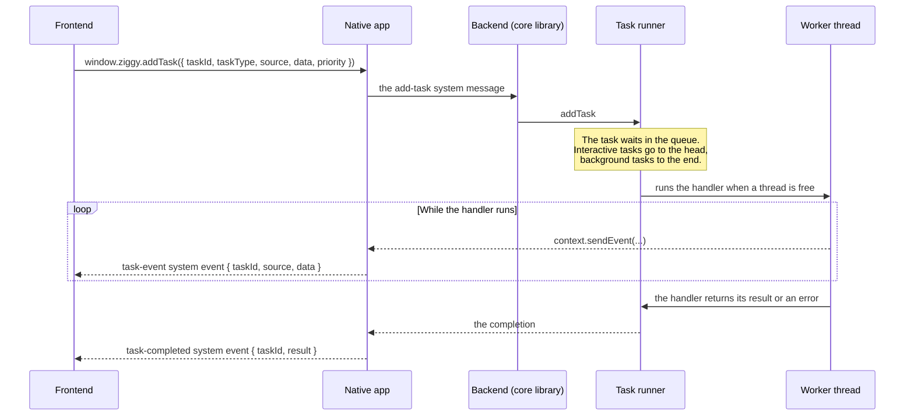

# Tasks

A task is work the backend runs on its own pool of worker threads, away from the thread that handles the frontend's messages. Anything slow (reading files, hashing, talking to the network, waiting on the user in a native dialog) is a task. A task can report progress while it runs, queue child tasks and be cancelled. See the [glossary](../glossary.md) for "the frontend", "the backend" and "the native app".

## How it works



- The frontend makes up the task's id and names a source. The source groups tasks so they can be cancelled together.
- There is one queue. An interactive task goes at the head of it and a background task at the end. A task with no priority runs as background.
- The native app sets the number of worker threads and the limit on child tasks in flight when it creates the backend (`ziggy_create`).
- A task that is cancelled ends as failed, with the error message `Cancelled`.

The `/ziggy:add-task` Claude Code command adds a task type to an app by following this guide.

## Writing a handler

A handler is a Zig function that takes the task's context and the data the frontend queued it with, and returns the JSON text of its result, or null for none. Returning an error fails the task. The error message is the error's name, unless the app sets `describe_error` to a function that describes it.

```zig
const std = @import("std");
const ziggy = @import("ziggy");

const TaskContext = ziggy.task_runner.TaskContext;

//
// The hello-world task: sends the frontend one output event while it runs, then completes with a result.
//
pub fn helloWorldTaskHandler(context: *TaskContext, data: std.json.Value) anyerror!?[]const u8 {
    _ = data;

    // Sends the frontend an event while the task runs, which the frontend hears through window.ziggy.onTaskEvent.
    try context.sendEvent(.{
        .type = "output",
        .text = "Hello world from a task",
    });

    // Completes the task with the JSON text of its result, allocated from the task's arena.
    return try context.arena.dupe(u8, "\"hello world task done\"");
}
```

Allocate from `context.arena`. It lives as long as the task.

What the context gives a handler:

| Method | What it does |
|---|---|
| `sendEvent(value)` | Sends any value `std.json` can serialise to the frontend as a `task-event` system event. `sendRawEvent(json)` sends JSON text. |
| `isCancelled()` | Whether the task's source has been cancelled. |
| `checkCancelled()` | Returns `error.Cancelled` when the source has been cancelled. Call it at the top of every loop. |
| `queueChild(type, data, priority)` | Queues a child task and returns its id. It waits while the child limit is reached. |
| `awaitTask(child_id)` | Waits for one child and returns how it ended. A failed child is returned as a failure. |
| `awaitAllTasks()` | Waits for every child of this task. |
| `runChild(allocator, type, data, priority)` | Runs one child to its end and frees it, for a task that runs children one after another for as long as it lives. |
| `io()` | The `std.Io` for sleeping and file access. |
| `config()` | The configuration the native app gave the backend, including its native calls and the app's data directory. |
| `appState()` | The app's own state, when it keeps any. |
| `taskId()`, `taskType()` and `source()` | The task's id, its task type (for a handler that serves several) and the source it was queued under. |
| `maxConcurrentChildTasks()` | The limit on this task's child tasks in flight. |
| `hostRequest(method, request_json)` | Calls the native app's `host_request` native call to do one thing only the platform can do, by name, and returns its result. A platform with no `host_request` native call gives `error.HostCallbackMissing`. |
| `hostRequester(storage)` | Hands this task's native calls to code that does not know about tasks, or null when the native app has no `host_request` native call. |
| `pickPaths(kind, title, initial_name)` | Shows a native file or directory dialog and returns the JSON text of the paths chosen, an empty array when the user cancelled. In a test hooks build a test can supply the paths instead. |

## Registering a handler

The app lists its task types in the `.tasks` field of its `ziggy.core.App` (see [Declaring the app](messages.md#declaring-the-app)), in `backend/src/app.zig` in the template. Each field is a task type and its handler:

```zig
.tasks = .{
    .@"hello-world-task" = hello_world.helloWorldTaskHandler,
},
```

- The field's name is the task type the frontend queues it under.
- A task type is `.normal` unless it is given as `.{ .handler = ..., .kind = .keep_alive }`. A keep-alive task keeps the app running on a mobile device while it is in the background (see "Keep-alive tasks" below).
- A task type that nothing is registered for fails as `UnknownTaskType`, in a failed `task-completed` event.

The task types in `.tasks` are registered when the backend starts. The app can register more at any point while the backend runs, from any thread, with `core.registerTask(task_type, handler)`, which takes a task handler or `.{ .handler = ..., .kind = ... }` as `.tasks` does. The task type can be queued from then on. A task type that is registered already is the error `DuplicateTaskType`. Its name is printed.

```zig
try core.registerTask("hello-later", helloLaterTaskHandler);
```

## Queuing a task from the frontend

```typescript
window.ziggy.addTask({
    taskId: "my-task-1",
    taskType: "hello-short",
    source: "my-source",
    data: {},
    priority: "background",
});
```

- `taskId`: the id the frontend makes up for the task. The task's events carry it, so the frontend can tell which task they belong to.
- `taskType`: the name the handler was registered under.
- `source`: the group the task belongs to, for cancelling.
- `data`: any JSON. It is the handler's `data`.
- `priority`: `"interactive"` for something the user is waiting on, `"background"` for everything else. Leave it out for background.

## Receiving the events

```typescript
window.ziggy.onTaskEvent(event => {
    // event.taskId, event.source, and event.data (what the handler sent)
});

window.ziggy.onTaskCompleted(event => {
    // event.taskId, and event.result:
    //   status: "succeeded" or "failed"
    //   errorMessage: why it failed ("Cancelled" for a cancelled task)
    //   outputs: what the handler returned
    //   type: the task type
    //   inputs: the data the task was queued with
});
```

Every event a handler sends arrives as one `task-event` event. The template gives each event a `type` field (`"output"`, `"job-progress"`) and the frontend decides what to do with it from that. Ziggy does not look inside an event. `removeTaskEventListener(callback)` and `removeTaskCompletedListener(callback)` stop a callback hearing them.

## Cancelling

```typescript
window.ziggy.cancelTasks("my-source");
```

Cancelling a source cancels its queued and running tasks, children included. A running task stops only when its handler next calls `checkCancelled()` or `isCancelled()`, so a handler that loops must check at every step.

## Child tasks

A handler can split its work into child tasks with `queueChild` and wait for them with `awaitTask` or `awaitAllTasks`. Ziggy's test app does this in `hello-long`, in `apps/ziggy-test-app/backend/src/lib/hello-tasks.zig`.

- Children run on the same pool as their parent. A parent that waits gives up its worker thread while it waits, so the pool cannot deadlock when every thread is held by a waiting parent.
- A child runs at the priority passed to `queueChild` or `runChild`, and otherwise at its parent's.
- A failed child makes `awaitTask` return its failure to the parent.

## A message answered by a task

A message the frontend sends with `window.ziggy.invoke` is handled by its message handler on the thread that handles the frontend's messages, so it must be quick. When the message response takes time, the handler answers it with a task instead: it returns a `ziggy.core.Answer(Response)` holding `.task`, with the task type and the task's input as JSON text. Ziggy queues a task of that type. The task's result is the message response. A task that fails or is cancelled gives an error message response. Ziggy's test app answers its file and directory pickers this way, because they wait on a native dialog, in `apps/ziggy-test-app/backend/src/lib/pickers.zig`:

```zig
pub fn pickFolderMessageHandler(core: *ziggy.core.Core, arena: std.mem.Allocator, request: PickFolderRequest) !ziggy.core.Answer(?[]const u8) {
    _ = core;
    return .{
        .task = .{
            .task_type = "pick-folder",
            .data = try json.stringify(arena, request),
        },
    };
}
```

- The handler decides what the task's input is: here the whole of the request.
- These tasks run under the source `"request"`, so `cancelTasks("request")` cancels every one still running.
- A message sent with `send` has no id and so nothing to answer: it fails with `MessageHasNoId` and nothing is queued.
- The task is not one the frontend queued, so it sends no `task-completed` event of its own: its result reaches the frontend only as the message response.
- A handler that takes the message unparsed (see [Messages](messages.md#taking-the-message-unparsed)) does the same by returning `core.answerWithTask(message, task_type, data_json)`.

## Keep-alive tasks

A task type registered with `kind = .keep_alive` keeps a mobile app running in the background while any task of that type is queued or running. Its children are covered by it. The frontend queues it like any other task.

- **Android:** a foreground service runs with an ongoing notification, whose wording the app sets with `ZiggyShell.setKeepAliveNotification`. Finishing the activity still ends the app's tasks.
- **iOS:** the app holds a background task assertion, which the system ends after a limited time and then suspends the app.
- **Linux, Windows and macOS:** nothing changes. Closing the window quits the app.

## Code written against the task queue

The core library implements the task queue's `IQueueBackend` on its own runner, so code written against `TaskQueue` and `IQueueBackend` (`@import("ziggy").task_queue`) runs on it unchanged.

- A handler registered with `worker.registerHandler` runs for any task type the app has no entry of its own for. Register handlers before queuing work.
- A task queued through the backend runs at the priority of the task running on that thread, unless the code passes one.
- `onTaskComplete` callbacks hear of every task that ran, a cancelled one as failed with the message `Cancelled`. A task cancelled while it waited in the queue is not reported to them, though the frontend is told.

## Key files

| File | What it holds |
|---|---|
| `packages/ziggy/core/src/lib/task-runner.zig` | The task runner, `TaskContext`, `TaskHandlerEntry`, `TaskPriority` and `TaskKind`. |
| `packages/ziggy/core/src/lib/system-messages/tasks.zig` | Ziggy's own `add-task` and `cancel-tasks` system messages. |
| `packages/ziggy/core/src/lib/core.zig` | `Core.registerTask` and `Core.answerWithTask`. |
| `packages/ziggy/core/src/lib/handlers.zig` | `Answer`, whose `.task` answers a message with a task. |
| `packages/ziggy/core/src/lib/task-queue` | The task queue that Ziggy's core library implements its queue backend for. |
| `apps/ziggy-template/backend/src/lib/hello-world.zig` | The template's hello world task. |
| `apps/ziggy-test-app/backend/src/lib/hello-tasks.zig` | The test app's task handlers: long tasks, child tasks, cancelling, failing and keep-alive. |
| `apps/ziggy-template/frontend/src/main.ts` | How the template's frontend queues tasks and handles their events. |

## See also

- [Claude Code commands](claude-code-commands.md): `/ziggy:add-task` and the other slash commands.
- [Ziggy architecture](../development/architecture.md#tasks): where tasks fit in an app.
